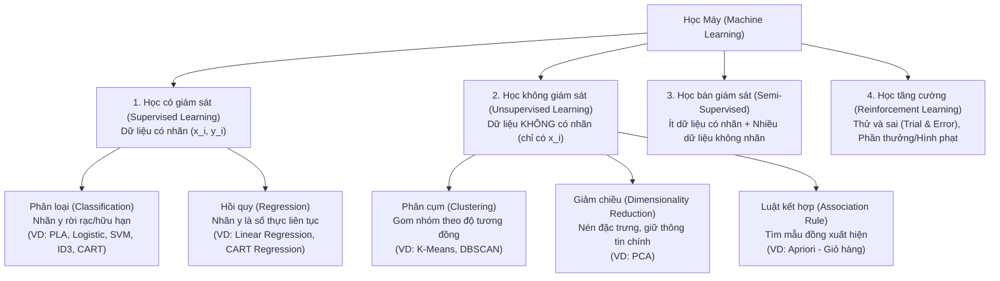
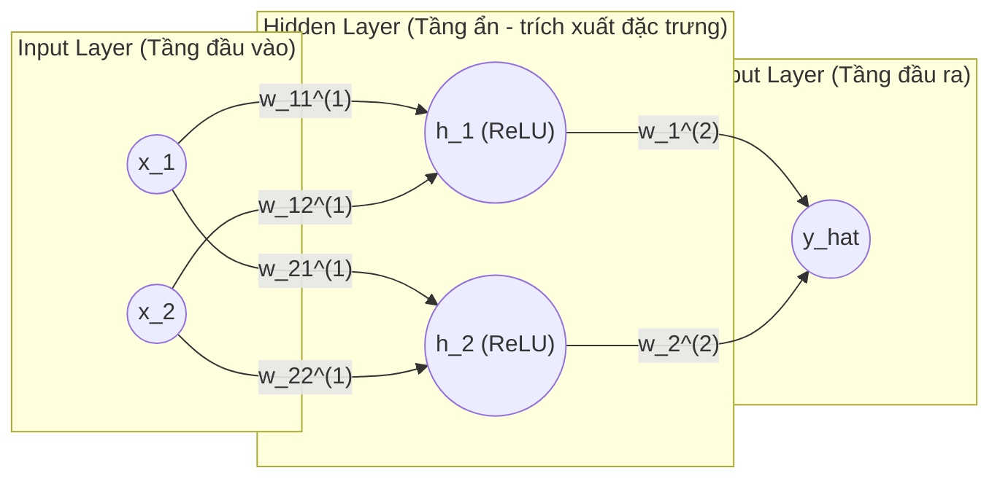

# Cẩm Nang Ôn Tập Toàn Diện Môn Học Máy (Machine Learning)
**Biên soạn dựa trên 100% Bộ Slide Bài Giảng & Sách Bài Tập Học Máy — Khoa CNTT, Trường Đại học Thủy Lợi (TS. Tạ Quang Chiểu & TS. Nguyễn Thị Kim Ngân)**

> [!IMPORTANT]
> **Cấu trúc chương trình & Mẹo đối chiếu tài liệu:**
> Trong bộ tài liệu gốc, **Slide bài giảng** và **Sách bài tập (`Bai_tap_Hoc_may_v6_Image.pdf`)** có sự chênh lệch nhỏ về số thứ tự chương (do Sách bài tập bổ sung thêm **Chương 4: Mạng Nơ-ron nhân tạo (ANN)** và **thuật toán DBSCAN** ở Chương 7). Tài liệu này tích hợp **đầy đủ 100% cả hai nguồn** và ghi rõ ánh xạ giữa Slide và Sách bài tập để bạn dễ dàng tra cứu khi ôn thi.

| Chủ đề kiến thức | Slide Bài Giảng | Sách Bài Tập | Trọng tâm thi (Lý thuyết + Tính tay) |
| :--- | :--- | :--- | :--- |
| **Giới thiệu Học máy & Toán cơ sở (Naive Bayes)** | Chương 1 | Chương 1 | Phân loại học máy, chuẩn $L_1/L_2$, Định lý Bayes & Lọc Spam (Laplace smoothing) |
| **Hồi quy tuyến tính, Quá khớp & Regularization** | Chương 2 | Chương 2 | MSE, Phương trình đạo hàm bằng 0 (Normal Eq), Overfitting/Underfitting, K-Fold CV, Ridge ($L_2$) vs LASSO ($L_1$) |
| **Gradient Descent (GD) & Perceptron (PLA)** | Chương 3.1 & 3.2 | Chương 3 | Công thức cập nhật GD, Learning rate $\eta$, BGD vs SGD vs MBGD, Cập nhật trọng số PLA |
| **Mạng Nơ-ron Nhân tạo (ANN / MLP)** | *(Nâng cao từ PLA)* | Chương 4 | Kiến trúc MLP, Hàm kích hoạt (ReLU, Sigmoid), Lan truyền xuôi (Forward) & Lan truyền ngược (Backpropagation) |
| **Cây quyết định (Decision Tree: ID3 & CART)** | Chương 4.1 & 4.2 | Chương 5 | Tính Entropy, Information Gain (ID3), Chỉ số Gini & Reduction in Variance (CART), Cắt tỉa cây (Pruning) |
| **Hồi quy Logistic & Máy Vector Hỗ trợ (SVM)** | Chương 5.1 & 5.2 | Chương 6 | Hàm Sigmoid, Binary Cross-Entropy, Cập nhật GD cho Logistic; Siêu phẳng SVM, Support Vectors, Margin, Soft-margin ($C, \xi$), Kernel trick |
| **Học không giám sát: K-Means, DBSCAN & PCA** | Chương 6.1 & 6.2 | Chương 7 | Thuật toán K-Means, WCSS (Inertia), Elbow; DBSCAN ($\varepsilon, \text{minPts}$, Core/Border/Noise); Giảm chiều PCA (7 bước) |
| **Học kết hợp (Ensemble Learning)** | Chương 7 | Chương 8 | Bootstrapping, Bagging (Random Forest, OOB), Boosting (AdaBoost, Gradient Boosting, XGBoost), Stacking |
| **Đánh giá và Lựa chọn Mô hình** | Chương 8 | Rải rác Ch.2, 3, 8 | Hold-out, Stratified, K-Fold, LOOCV, Confusion Matrix, Accuracy, Precision, Recall, $F_1$-score, Micro/Macro-averaging |

---

## Chương 1: Giới Thiệu Về Học Máy & Cơ Sở Toán Học
*(Tương ứng: `Chapter_1_Introduction.pdf` & Chương 1 Sách bài tập)*

### 1. Định nghĩa Học máy (Tom Mitchell, 1997)
Một chương trình máy tính được gọi là **học** từ kinh nghiệm $E$ (Experience) đối với một lớp các tác vụ $T$ (Task) và thước đo hiệu năng $P$ (Performance measure), nếu hiệu năng của nó tại các tác vụ trong $T$, được đo bởi $P$, được cải thiện theo kinh nghiệm $E$.
* **Ví dụ Lọc thư rác (Spam Email):**
  * $T$: Phân loại một email mới là thư rác (`Spam`) hay thư thường (`Not Spam` / `Ham`).
  * $E$: Tập dữ liệu các email trong quá khứ đã được người dùng gắn nhãn `Spam` hoặc `Ham`.
  * $P$: Tỷ lệ phần trăm email được phân loại chính xác (Accuracy).

### 2. Phân loại các phương pháp Học máy

### 3. Ôn tập Toán cơ sở cho Học máy
1. **Biểu diễn dữ liệu ma trận:**
   * Nếu tập dữ liệu viết dưới dạng ma trận $X \in \mathbb{R}^{m \times n}$ (theo quy ước chuẩn trong Sách bài tập câu `1.10`): có **$m$ mẫu dữ liệu (samples/rows)**, mỗi mẫu có **$n$ đặc trưng (features/columns)**.
   * *(Lưu ý: Trong một số slide của TS. Vũ Hữu Tiệp như bài PCA, mỗi điểm dữ liệu $x_i \in \mathbb{R}^D$ được xếp thành 1 cột của ma trận $X \in \mathbb{R}^{D \times N}$ — khi đọc đề cần chú ý kích thước được mô tả).*
2. **Chuẩn của vector (Vector Norms):** Cho vector $x = [x_1, x_2, \dots, x_n]^T \in \mathbb{R}^n$:
   * **Chuẩn $L_1$ (Manhattan norm):** $\|x\|_1 = \sum_{i=1}^n |x_i|$ (Tổng trị tuyệt đối các phần tử).
   * **Chuẩn $L_2$ (Euclidean norm - Độ dài Euclid):** $\|x\|_2 = \sqrt{\sum_{i=1}^n x_i^2} = \sqrt{x^T x}$.
3. **Tích vô hướng (Dot Product / Inner Product):**
   $$x^T y = \sum_{i=1}^n x_i y_i = \|x\|_2 \|y\|_2 \cos(\theta)$$
   * Hai vector **càng cùng hướng** ($\theta \to 0^\circ \implies \cos\theta \to 1$) và có **độ lớn càng lớn** thì tích vô hướng càng lớn.
   * Hai vector **vuông góc (trực giao)** khi và chỉ khi $x^T y = 0$.

### 4. Định lý Bayes & Bộ phân loại Naive Bayes (Lọc Spam)
* **Định lý Bayes:** Ước lượng xác suất hậu nghiệm (posterior) dựa trên bằng chứng mới:
  $$P(A \mid B) = \frac{P(B \mid A) P(A)}{P(B)}$$
  Trong đó:
  * $P(A)$: Xác suất tiên nghiệm (Prior probability) của lớp $A$.
  * $P(B \mid A)$: Xác suất hợp lý (Likelihood) — xác suất quan sát thấy đặc trưng $B$ khi biết mẫu thuộc lớp $A$.
  * $P(A \mid B)$: Xác suất hậu nghiệm (Posterior probability) — xác suất mẫu thuộc lớp $A$ sau khi thấy bằng chứng $B$.
  * **Chú ý bẫy trắc nghiệm (Câu `1.16`):** Ký hiệu $P(\text{"mua"} \mid \text{Spam})$ đọc là: *"Xác suất từ 'mua' xuất hiện với điều kiện email đó là spam"*, **KHÔNG** phải xác suất email là spam khi thấy từ "mua" ($P(\text{Spam} \mid \text{"mua"})$).
* **Bộ phân loại Naive Bayes (Naive Bayes Classifier):**
  * Giả định **"Ngây thơ" (Naive assumption):** Các đặc trưng $x_1, x_2, \dots, x_d$ **độc lập có điều kiện (conditionally independent)** với nhau khi đã biết nhãn lớp $c$:
    $$P(x_1, x_2, \dots, x_d \mid c) = \prod_{i=1}^d P(x_i \mid c)$$
  * Quy tắc phân lớp MAP (Maximum A Posteriori):
    $$\hat{c} = \arg\max_{c \in C} P(c) \prod_{i=1}^d P(x_i \mid c)$$
* **Làm mượt Laplace (Laplace Smoothing):**
  * **Vấn đề:** Nếu một từ $x_k$ chưa từng xuất hiện trong lớp $c$ ở tập huấn luyện thì $P(x_k \mid c) = 0$, làm cho toàn bộ tích $\prod_{i=1}^d P(x_i \mid c) = 0$.
  * **Giải pháp:** Cộng thêm $\alpha = 1$ vào tử số và cộng kích thước từ điển $|V|$ vào mẫu số:
    $$P(x_i \mid c) = \frac{\text{count}(x_i, c) + 1}{\sum_{w \in V} \text{count}(w, c) + |V|}$$

---

## Chương 2: Hồi Quy Tuyến Tính (Linear Regression), Quá Khớp & Regularization
*(Tương ứng: `Chapter_2_Linear_Regression.pdf` & Chương 2 Sách bài tập)*

### 1. Mô hình Hồi quy Tuyến tính
* **Mục tiêu:** Dự báo một giá trị đầu ra **liên tục** $y \in \mathbb{R}$ từ vector đặc trưng đầu vào $x$.
* **Hồi quy tuyến tính đơn (1 biến):** $\hat{y} = w_1 x + w_0$ (hoặc $\hat{y} = wx + b$), trong đó:
  * $w$ (weight): Trọng số của đặc trưng (hệ số góc / độ dốc).
  * $b$ hoặc $w_0$ (bias / intercept): Hệ số chặn.
* **Hồi quy tuyến tính đa biến ($d$ đặc trưng) & Mẹo mở rộng Bias (Bias Trick):**
  * Đặt vector trọng số mở rộng $w = [w_0, w_1, w_2, \dots, w_d]^T$ và vector đặc trưng mở rộng $\bar{x} = [1, x_1, x_2, \dots, x_d]^T$.
  * Phương trình dự đoán gọn thành tích vô hướng:
    $$\hat{y} = w^T \bar{x} = \bar{x}^T w$$

### 2. Hàm mất mát MSE & Nghiệm dạng đóng (Normal Equation)
* **Hàm mất mát Mean Squared Error (MSE - Trung bình bình phương sai số):**
  $$L(w) = \frac{1}{2N} \sum_{i=1}^N (y_i - w^T \bar{x}_i)^2 = \frac{1}{2N} \|\bar{X}w - y\|_2^2$$
  *(Hệ số $\frac{1}{2}$ được thêm vào để khi lấy đạo hàm bậc hai triệt tiêu với số $2$, không làm thay đổi điểm cực tiểu $w^*$).*
* **Đạo hàm (Gradient) của hàm mất mát:**
  $$\nabla_w L(w) = \frac{1}{N} \bar{X}^T (\bar{X}w - y)$$
* **Nghiệm giải tích (Normal Equation):** Cho đạo hàm bằng $0$:
  $$\bar{X}^T \bar{X} w = \bar{X}^T y \implies w^* = (\bar{X}^T \bar{X})^{-1} \bar{X}^T y = \bar{X}^\dagger y$$
  *(Nếu $\bar{X}^T \bar{X}$ suy biến/không khả nghịch, ta dùng ma trận giả nghịch đảo Moore-Penrose $\bar{X}^\dagger$).*

### 3. Overfitting (Quá khớp) vs. Underfitting (Chưa khớp)

| Tiêu chí | Underfitting (Chưa khớp / Độ lệch cao - High Bias) | Mô hình Tốt (Just Right) | Overfitting (Quá khớp / Phương sai cao - High Variance) |
| :--- | :--- | :--- | :--- |
| **Bản chất** | Mô hình quá đơn giản (bậc đa thức quá thấp), chưa nắm bắt được quy luật dữ liệu. | Mô hình nắm bắt đúng quy luật tổng quát. | Mô hình quá phức tạp (bậc đa thức quá cao), học thuộc lòng cả **nhiễu (noise)** trong tập train. |
| **Training Error** | **Cao** | Thấp | **Rất thấp** (gần bằng 0) |
| **Validation / Test Error** | **Cao** | **Thấp nhất** | **Cao** (vọt lên cao) |
| **Cách khắc phục** | Tăng độ phức tạp mô hình, thêm đặc trưng (features), giảm hệ số regularization $\lambda$. | Giữ nguyên. | Thêm dữ liệu huấn luyện, giảm độ phức tạp, dùng **Regularization** ($L_1, L_2$), **Early Stopping**, hoặc **Pruning**. |

> [!TIP]
> **Quy luật biến thiên sai số khi độ phức tạp mô hình tăng lên:**
> * **Training Error:** Luôn **giảm dần** khi độ phức tạp mô hình tăng.
> * **Validation / Test Error:** Ban đầu giảm (thoát khỏi Underfitting), đạt cực tiểu tại độ phức tạp tối ưu, sau đó **tăng mạnh** (rơi vào Overfitting).

### 4. Tập Validation & Đánh giá chéo K-Fold (K-Fold Cross Validation)
* **Cách chia dữ liệu chuẩn:** Toàn bộ tập dữ liệu $D$ được chia thành `Training set` (huấn luyện tham số $w$), `Validation set` (được trích ra từ Training set dùng để chọn siêu tham số/đánh giá khả năng tổng quát hóa trong lúc chọn mô hình) và `Test set` (chỉ dùng 1 lần cuối cùng để báo cáo hiệu năng). Mô hình tốt nhất là mô hình có **Validation error nhỏ nhất**.
* **K-Fold Cross Validation (Đánh giá chéo K-phần):**
  1. Chia tập dữ liệu huấn luyện thành $K$ phần (folds) bằng nhau, không giao nhau (thường chọn $K = 5$ hoặc $K = 10$).
  2. Lặp $K$ lần: Ở lần lặp thứ $i$, dùng fold thứ $i$ làm **Validation set** và $K-1$ folds còn lại làm **Training set**.
  3. Tính sai số trung bình cộng qua $K$ lần lặp.
  * **Ưu điểm:** Rất hữu ích khi **dữ liệu ít (vừa và nhỏ)**, tránh phụ thuộc vào một cách chia ngẫu nhiên duy nhất và mọi mẫu đều được dùng để kiểm thử đúng 1 lần.

### 5. Các kỹ thuật Chính quy hóa (Regularization)
Mục tiêu chính của Regularization là **giảm độ phức tạp của mô hình** (kiểm soát độ lớn trọng số $w$) để chống **Overfitting** bằng cách tối thiểu hóa đồng thời cả `Training Loss` và `Regularization Term`:
$$J(w) = L(w) + \lambda R(w)$$

1. **Early Stopping (Dừng sớm):**
   * Theo dõi `Training error` và `Validation error` sau mỗi vòng lặp (epoch).
   * Dừng quá trình huấn luyện ngay khi **Validation error bắt đầu có xu hướng tăng lên** (dù Training error vẫn đang giảm).
   * Đây là một dạng regularization theo thời gian vì nó ngăn trọng số $w$ bị đẩy đi quá xa để khớp vào nhiễu.
2. **So sánh Ridge Regression ($L_2$) và LASSO Regression ($L_1$):**

| Tiêu chí | Ridge Regularization ($L_2$) | LASSO Regularization ($L_1$) |
| :--- | :--- | :--- |
| **Công thức hàm mất mát** | $J(w) = \frac{1}{2N}\|\bar{X}w - y\|_2^2 + \lambda \|w\|_2^2 = L(w) + \lambda \sum_{j=1}^d w_j^2$ | $J(w) = \frac{1}{2N}\|\bar{X}w - y\|_2^2 + \lambda \|w\|_1 = L(w) + \lambda \sum_{j=1}^d |w_j|$ |
| **Cơ chế hoạt động** | Phạt theo bình phương trọng số (hình cầu/hình tròn). Ép các trọng số **nhỏ lại gần 0** nhưng hầu như **không bằng 0 tuyệt đối**. | Phạt theo trị tuyệt đối trọng số (hình thoi có các góc nhọn trên trục tọa độ). Có khả năng ép các trọng số dư thừa **về đúng bằng 0** ($w_j = 0$). |
| **Khả năng chọn đặc trưng** | **Không** loại bỏ hoàn toàn đặc trưng (giữ lại tất cả đặc trưng với trọng số nhỏ). | **Có khả năng lựa chọn đặc trưng (Feature Selection)** tự động vì tạo ra nghiệm thưa (sparse solution). |
| **Trường hợp sử dụng** | Khi hầu hết các đặc trưng đều mang thông tin hữu ích hoặc có hiện tượng đa cộng tuyến (multicollinearity). | Khi dữ liệu có rất nhiều đặc trưng nhưng chỉ một số ít đặc trưng thực sự quan trọng, cần lọc bỏ đặc trưng nhiễu. |

---

## Chương 3: Gradient Descent (GD) & Thuật Toán Perceptron (PLA)
*(Tương ứng: `Chapter_3.1_Gradient_Descent.pdf`, `Chapter_3.2_PLA.pdf` & Chương 3 Sách bài tập)*

### 1. Thuật toán Hạ Gradient (Gradient Descent - GD)
* **Ý tưởng cơ bản:** Đạo hàm (Gradient) $\nabla L(w)$ chỉ hướng làm hàm số **tăng nhanh nhất**. Do đó, để **tối thiểu hóa** hàm mất mát $L(w)$, ta phải di chuyển tham số $w$ theo **hướng ngược với hướng của gradient**:
  $$w \leftarrow w - \eta \nabla L(w)$$
  *(Với hàm 1 biến $f(x)$: $x^{(t+1)} = x^{(t)} - \eta f'(x^{(t)})$).*
* **Vai trò của tốc độ học $\eta$ (Learning Rate):** Quyết định **kích thước bước cập nhật tham số**:
  * **$\eta$ quá nhỏ:** Thuật toán hội tụ **rất chậm**, tốn nhiều vòng lặp và dễ bị kẹt ở cực tiểu địa phương nông.
  * **$\eta$ quá lớn:** Bước nhảy quá dài khiến hàm mất mát **dao động mạnh** qua lại hai bên sườn dốc, bỏ qua điểm tối ưu hoặc **phân kỳ (diverge)** ra vô cùng.
  * **$\eta$ hợp lý:** Hàm mất mát giảm đều đặn và hội tụ nhanh về điểm cực tiểu.
* **Điều kiện dừng của GD:**
  1. Độ lớn của gradient xấp xỉ bằng $0$: $\|\nabla L(w)\| < \epsilon$ (ví dụ $10^{-6}$).
  2. Độ thay đổi của hàm mất mát giữa 2 bước liên tiếp rất nhỏ: $|L(w^{(t+1)}) - L(w^{(t)})| < \epsilon$.
  3. Đạt số vòng lặp tối đa (`max_epochs` / `max_iters`).

### 2. So sánh 3 biến thể của Gradient Descent

| Tiêu chí | Batch Gradient Descent (BGD) | Stochastic Gradient Descent (SGD) | Mini-batch Gradient Descent (MBGD) |
| :--- | :--- | :--- | :--- |
| **Dữ liệu mỗi lần cập nhật** | Toàn bộ tập huấn luyện ($N$ mẫu). | **1 mẫu dữ liệu** ngẫu nhiên duy nhất $(x_i, y_i)$. | Một nhóm nhỏ (**mini-batch**) gồm $k$ mẫu ($1 < k < N$, thường $k = 32, 64, 128$). |
| **Số lần cập nhật trong 1 Epoch** | $1$ lần. | $N$ lần. | $\approx \frac{N}{k}$ lần. *(VD: $N=1000, k=50 \implies 20$ lần cập nhật/epoch)*. |
| **Chi phí tính toán 1 bước** | Rất cao: $\mathcal{O}(N \cdot d)$. | Rất thấp: $\mathcal{O}(d)$. | Trung bình thấp: $\mathcal{O}(k \cdot d)$, tận dụng tốt tính toán song song GPU/vector hóa. |
| **Đường đi & Tốc độ hội tụ** | Đường đi mượt, ổn định thẳng tới cực tiểu nhưng rất chậm trên dữ liệu lớn. | Dao động mạnh (noisy), nhưng cập nhật tức thời rất nhanh; dao động giúp thoát cực tiểu địa phương. | Cân bằng hoàn hảo: hội tụ nhanh như SGD nhưng ổn định hơn nhiều nhờ trung bình trên $k$ mẫu. |
| **Trường hợp áp dụng** | Tập dữ liệu nhỏ, hàm mất mát lồi. | Tập dữ liệu cực lớn hoặc **học trực tuyến theo thời gian thực (Online Learning)**. | **Phổ biến nhất** trong Học sâu (Deep Learning) và Học máy hiện đại. |

### 3. Thuật toán Perceptron (Perceptron Learning Algorithm - PLA)
* **Tác giả & Bài toán:** Đề xuất bởi **Frank Rosenblatt (1957)** cho bài toán **Phân lớp nhị phân (Binary Classification)** với nhãn $y \in \{-1, +1\}$ trên tập dữ liệu phân tách tuyến tính.
* **Siêu phẳng phân tách & Hàm dự đoán:**
  * Với vector đầu vào đã ghép bias $\bar{x} = [1, x_1, \dots, x_d]^T$ (hoặc $[x_1, \dots, x_d, 1]^T$ tùy quy ước đề bài), siêu phẳng phân tách có phương trình $w^T x = 0$.
  * Nhãn dự đoán của mẫu $x$ dựa trên **dấu của $w^T x$**:
    $$\hat{y} = \text{sgn}(w^T x) = \begin{cases} +1 & \text{nếu } w^T x \ge 0 \\ -1 & \text{nếu } w^T x < 0 \end{cases}$$
* **Kiểm tra điểm bị phân lớp sai (Misclassified point):**
  * Mẫu $(x_i, y_i)$ bị phân lớp **SAI** khi dấu của $w^T x_i$ khác $y_i$, tức là:
    $$y_i (w^T x_i) \le 0 \quad (\text{hay } \hat{y}_i \neq y_i)$$
* **Hàm mất mát Perceptron & Quy tắc cập nhật trọng số:**
  * Tập các điểm bị phân lớp sai là $\mathcal{M}$. Hàm mất mát:
    $$J(w) = \sum_{x_i \in \mathcal{M}} (-y_i w^T x_i)$$
  * Đạo hàm tại 1 điểm bị phân lớp sai $x_i \in \mathcal{M}$ là $\nabla_w J(w; x_i) = -y_i x_i$.
  * **Quy tắc cập nhật trọng số Perceptron** (với tốc độ học $\eta = 1$ hoặc $\eta > 0$):
    $$w \leftarrow w + \eta y_i x_i \quad (\text{thường viết gọn với } \eta=1: \quad w \leftarrow w + y_i x_i)$$
* **Điều kiện hội tụ:** PLA **đảm bảo hội tụ** sau số bước hữu hạn khi và chỉ khi dữ liệu **phân tách tuyến tính được (linearly separable)**. Nếu dữ liệu có nhiễu không phân tách tuyến tính hoàn toàn, ta dùng thuật toán **Pocket** (lưu lại bộ trọng số $w$ tạo ra ít điểm sai nhất).

> [!NOTE]
> **Phương pháp giải bài tập tính tay GD & PLA (Câu `3.26`, `3.27`, `3.28`):**
> * **Bài toán GD 1 biến (`3.26`):** Tính $f'(x)$, sau đó lập bảng qua từng bước $k = 1, 2, 3, 4$: $x^{(k)} = x^{(k-1)} - \eta f'(x^{(k-1)})$ và tính $f(x^{(k)})$ để thấy giá trị hàm giảm dần về cực tiểu.
> * **Bài toán PLA (`3.27`, `3.28`):**
>   1. Tính tích vô hướng $z = w^T x = \sum w_j x_j$.
>   2. Nếu $z > 0 \implies \hat{y} = +1$; nếu $z < 0 \implies \hat{y} = -1$.
>   3. So sánh $\hat{y}$ với nhãn thật $y$: Nếu $\hat{y} \neq y$ (tức $y \cdot z \le 0$) thì điểm đó **bị phân lớp sai**.
>   4. Cập nhật: $w_{\text{mới}} = w_{\text{cũ}} + y \cdot x$. Tính lại $w_{\text{mới}}^T x = w_{\text{cũ}}^T x + y \|x\|_2^2$ để thấy giá trị đã dịch chuyển về đúng phía của nhãn $y$!

---

## Chương 4: Mạng Nơ-ron Nhân Tạo (Artificial Neural Networks - ANN / MLP)
*(Tương ứng: Chương 4 Sách bài tập)*

### 1. Cấu trúc Mạng Nơ-ron Nhiều Lớp (Multilayer Perceptron - MLP)

* **Input Layer (Tầng đầu vào):** Nhận trực tiếp vector đặc trưng $x = [x_1, x_2, \dots, x_n]^T$ từ dữ liệu bên ngoài.
* **Hidden Layer (Tầng ẩn):** Nằm giữa tầng đầu vào và tầng đầu ra. Gọi là "tầng ẩn" vì người dùng không quan sát trực tiếp các giá trị của tầng này trong tập dữ liệu đầu vào/đầu ra. Vai trò chính là **trích xuất và học các đặc trưng phi tuyến phức tạp** từ dữ liệu.
* **Output Layer (Tầng đầu ra):** Tạo ra kết quả dự đoán cuối cùng $\hat{y}$ của mạng.
* **Trọng số ($w_i$) & Bias ($b$):**
  * $w_i$ biểu diễn **trọng số kết nối** (mức độ ảnh hưởng của đầu vào).
  * **Bias $b$** dùng để **dịch chuyển hàm kích hoạt**, giúp nơ-ron linh hoạt hơn.
  * **Đếm số trọng số (Câu `4.12`):** Một tầng có $M$ nơ-ron nhận tín hiệu từ $D$ đầu vào sẽ có $D \times M$ trọng số kết nối (chưa tính bias) và cộng thêm $M$ tham số nếu tính cả bias.
  * **Khai báo `sklearn` (Câu `4.9`):** `hidden_layer_sizes=(3, 2)` nghĩa là mạng có **2 tầng ẩn**, tầng ẩn thứ nhất có 3 nơ-ron, tầng ẩn thứ hai có 2 nơ-ron.
* **Tại sao phải dùng Hàm kích hoạt phi tuyến (Non-linear Activation Function)?**
  * Nếu tất cả các nơ-ron trong tầng ẩn chỉ dùng hàm tuyến tính $f(z) = z$, thì hợp của nhiều phép biến đổi tuyến tính vẫn chỉ là **một phép biến đổi tuyến tính duy nhất** ($W^{(2)}(W^{(1)}x) = W_{\text{gộp}}x$). Khi đó việc thêm nhiều tầng ẩn **không làm tăng khả năng biểu diễn phi tuyến của mạng** (Câu `4.11`).
  * Các hàm kích hoạt phi tuyến phổ biến:
    * **ReLU (Rectified Linear Unit):** $\text{ReLU}(z) = \max(0, z)$. Đạo hàm: $\text{ReLU}'(z) = 1$ nếu $z > 0$, và $= 0$ nếu $z < 0$.
    * **Sigmoid:** $\sigma(z) = \frac{1}{1 + e^{-z}} \in (0, 1)$. Đạo hàm: $\sigma'(z) = \sigma(z)(1 - \sigma(z))$.

### 2. Lan truyền xuôi (Forward Propagation) & Lan truyền ngược (Backpropagation)
Giả sử mạng có 1 tầng ẩn và không có bias (như trong các bài tập tính tay `4.19`, `4.20`, `4.24`, `4.25`):
1. **Lan truyền xuôi (Forward Propagation):** Tính đầu ra của mạng từ dữ liệu đầu vào theo chiều $\text{Input} \to \text{Hidden} \to \text{Output}$:
   * Tín hiệu tuyến tính tại tầng ẩn: $z^{(1)} = W^{(1)} x$
   * Đầu ra kích hoạt tại tầng ẩn: $a^{(1)} = \text{ReLU}(z^{(1)})$
   * Tín hiệu tại tầng đầu ra: $z^{(2)} = W^{(2)} a^{(1)}$
   * Đầu ra dự đoán: $\hat{y} = a^{(2)} = \text{ReLU}(z^{(2)})$ (hoặc $\hat{y} = z^{(2)}$ nếu đầu ra tuyến tính; với $z^{(2)} > 0$ cả hai đều bằng $z^{(2)}$).
2. **Hàm mất mát (Loss Function):** Đo mức độ sai khác giữa dự đoán $\hat{y}$ và nhãn thật $y$:
   $$J = \frac{1}{2}(y - \hat{y})^2 = \frac{1}{2}(\hat{y} - y)^2$$
3. **Lan truyền ngược (Backpropagation):** Truyền sai số theo hướng ngược từ $\text{Output} \to \text{Hidden} \to \text{Input}$ dựa trên **Quy tắc đạo hàm hàm hợp (Chain Rule)** để tính **Gradient của hàm mất mát** theo từng ma trận trọng số:
   * Sai số tại tầng đầu ra:
     $$\delta^{(2)} = \frac{\partial J}{\partial \hat{y}} = \hat{y} - y = -(y - \hat{y})$$
   * **Gradient theo $W^{(2)}$:**
     $$\frac{\partial J}{\partial W^{(2)}} = \frac{\partial J}{\partial \hat{y}} \cdot \frac{\partial \hat{y}}{\partial W^{(2)}} = (\hat{y} - y) (a^{(1)})^T$$
   * **Gradient theo $W^{(1)}$:**
     $$\delta^{(1)} = \left((W^{(2)})^T \delta^{(2)}\right) \odot \text{ReLU}'(z^{(1)})$$
     $$\frac{\partial J}{\partial W^{(1)}} = \delta^{(1)} x^T$$
4. **Cập nhật trọng số bằng Gradient Descent:**
   $$W^{(l)} \leftarrow W^{(l)} - \eta \frac{\partial J}{\partial W^{(l)}}$$

---

## Chương 5: Phương Pháp Học Theo Mô Hình Cây (Decision Trees: ID3 & CART)
*(Tương ứng: `Chapter_4.1_ID3.pdf`, `Chapter_4.2_CART.pdf` & Chương 5 Sách bài tập)*

### 1. Thuật toán ID3 (Iterative Dichotomiser 3)
ID3 xây dựng cây quyết định phân lớp theo chiến lược **tham lam từ trên xuống (top-down greedy divide-and-conquer)**: tại mỗi nút, chọn thuộc tính tốt nhất để phân nhánh dựa trên **Entropy** và **Information Gain (Độ lợi thông tin)**.

* **Công thức Entropy tại tập dữ liệu $S$** (có $|S| = N$ mẫu thuộc $C$ lớp, mỗi lớp có $N_c$ mẫu, tỷ lệ $p_c = \frac{N_c}{N}$):
  $$H(S) = -\sum_{c=1}^C p_c \log_2(p_c)$$
  > [!WARNING]
  > **Cực kỳ lưu ý về cơ số Logarit ($\log_2$ vs $\ln$) khi đi thi:**
  > * Trong **Sách bài tập (Trắc nghiệm & Tự luận Chương 5)**: Đơn vị của Entropy được tính bằng **bit**, tức là dùng **$\log_2$** ($\log_2(x) = \frac{\ln(x)}{\ln(2)}$). Khi đó với 2 lớp bằng nhau ($50\% - 50\%$), $H(S) = 1\text{ bit}$.
  > * Trong **Slide bài giảng `Chapter_4.1_ID3.pdf` (trang 19-25)**: Ví dụ bảng Thời tiết 14 ngày của TS. Vũ Hữu Tiệp lại bấm máy theo **logarit tự nhiên $\ln$ (đơn vị nat)** nên ra $H(S) = -\frac{5}{14}\ln\frac{5}{14} - \frac{9}{14}\ln\frac{9}{14} \approx 0.65$ (nếu tính theo $\log_2$ sẽ là $0.940\text{ bit}$).
  > * **Bản chất toán học:** Do $\log_2(x) = \frac{\ln(x)}{\ln 2}$ chỉ khác nhau một hằng số nhân dương $\frac{1}{\ln 2}$, nên **thứ tự xếp hạng Information Gain và cấu trúc cây ID3 hoàn toàn giống hệt nhau** dù dùng $\log_2$ hay $\ln$! Khi làm bài tự luận tính tay, bạn nên ghi rõ công thức dùng $\log_2$ (bit) và có thể mở ngoặc ghi thêm giá trị $\ln$ để tuyệt đối ăn trọn điểm!

* **Tính chất của Entropy:**
  * $H(S) = 0$ khi nút **thuần khiết hoàn toàn** (tất cả mẫu trong $S$ thuộc cùng 1 lớp duy nhất, quy ước $0 \log 0 = 0$).
  * $H(S)$ đạt cực đại khi các lớp **phân bố đều nhau** ($p_1 = p_2 = \dots = \frac{1}{C}$).
* **Entropy trung bình có trọng số sau khi chia $S$ theo thuộc tính $A$** (có $K$ giá trị chia $S$ thành $S_1, S_2, \dots, S_K$):
  $$H(A, S) = \sum_{k=1}^K \frac{|S_k|}{|S|} H(S_k)$$
* **Độ lợi thông tin (Information Gain - IG):** Thể hiện **mức giảm Entropy trung bình** sau khi phân nhánh theo thuộc tính $A$:
  $$\text{Gain}(S, A) = H(S) - H(A, S) = H(S) - \sum_{k=1}^K \frac{|S_k|}{|S|} H(S_k)$$
* **Quy tắc chọn thuộc tính của ID3:** Chọn thuộc tính $A^*$ có **Information Gain lớn nhất** (tương đương với $H(A, S)$ nhỏ nhất):
  $$A^* = \arg\max_A \text{Gain}(S, A) = \arg\min_A H(A, S)$$
* **Điều kiện dừng của ID3:**
  1. Tất cả các mẫu trong nút thuộc cùng một lớp (Entropy $= 0 \implies$ trở thành nút lá mang nhãn lớp đó).
  2. Không còn thuộc tính nào để phân chia (trở thành nút lá mang nhãn xuất hiện nhiều nhất - Mode).
  3. Tập con $S_k$ rỗng (gán nhãn phổ biến nhất của nút cha).
* **Nhược điểm của ID3 gốc:**
  * Dễ bị thiên vị (ưu tiên) cho các thuộc tính có quá nhiều giá trị riêng biệt (ví dụ cột `ID`, `Ngày tháng` có $\text{Gain}$ cực đại nhưng vô nghĩa).
  * Không trực tiếp xử lý được thuộc tính số liên tục nếu không rời rạc hóa trước.
  * Không tự xử lý dữ liệu bị thiếu (missing values) và dễ bị Overfitting nếu không cắt tỉa.

### 2. Thuật toán CART (Classification And Regression Tree)
Khác với ID3 (tạo cây đa nhánh và chỉ dùng cho phân lớp), **CART luôn xây dựng cây nhị phân (binary tree)** (mỗi nút cha chỉ chia thành đúng 2 nút con) và áp dụng được cho **cả bài toán Phân lớp (Classification) lẫn Hồi quy (Regression)**.

| Tiêu chí | CART Phân lớp (Classification Tree) | CART Hồi quy (Regression Tree) |
| :--- | :--- | :--- |
| **Biến mục tiêu $y$** | Rời rạc / Hạng mục (Categorical). | Số thực liên tục (Continuous). |
| **Tiêu chí chọn phép chia** | **Chỉ số Gini (Gini Index)** — chọn phép chia có tổng Gini có trọng số của 2 nút con **nhỏ nhất** (tức độ giảm Gini lớn nhất). | **Giảm phương sai (Reduction in Variance / MSE)** — chọn phép chia làm phương sai có trọng số của 2 nút con **nhỏ nhất**. |
| **Giá trị dự đoán tại nút lá** | **Mode** (Nhãn lớp xuất hiện nhiều nhất trong nút lá). | **Mean** (Trung bình cộng của các giá trị mục tiêu $y$ trong nút lá). |

* **Công thức Chỉ số Gini (Gini Impurity) tại một nút $S$:**
  $$\text{Gini}(S) = 1 - \sum_{c=1}^C p_c^2$$
  * Nếu nút chỉ chứa 1 lớp duy nhất ($p_c = 1$): $\text{Gini}(S) = 1 - 1^2 = 0$ (thuần khiết hoàn toàn).
  * Với phân lớp nhị phân có tỷ lệ $(p, 1-p)$: $\text{Gini}(S) = 1 - p^2 - (1-p)^2 = 2p(1-p)$ (cực đại $= 0.5$ khi $p = 0.5$).
* **Tổng Gini có trọng số khi chia nút $S$ thành 2 nhánh $S_1, S_2$:**
  $$\text{Gini}_{\text{split}}(S) = \frac{|S_1|}{|S|} \text{Gini}(S_1) + \frac{|S_2|}{|S|} \text{Gini}(S_2)$$
  *(Phép chia tốt nhất là phép chia có $\text{Gini}_{\text{split}}(S)$ **nhỏ nhất**).*
* **Cách CART xử lý các loại thuộc tính để luôn tạo cây nhị phân:**
  * **Thuộc tính hạng mục có $\ge 3$ giá trị $\{X, Y, Z\}$:** Duyệt các cách **gộp thành 2 nhóm** (ví dụ $\{X\}$ vs $\{Y, Z\}$; $\{Y\}$ vs $\{X, Z\}$; $\{Z\}$ vs $\{X, Y\}$) để tìm phép chia nhị phân tốt nhất (Câu `5.18`).
  * **Thuộc tính số liên tục:** Sắp xếp các giá trị tăng dần và duyệt các **ngưỡng chia trung điểm** $t$ để tách thành 2 nhánh $x \le t$ và $x > t$ (Câu `5.9`).
* **Cắt tỉa cây (Pruning) & Điểm yếu cố hữu của Cây quyết định:**
  * **Cắt tỉa (Pre-pruning như giới hạn `max_depth`, `min_samples_split`, `min_samples_leaf` hoặc Post-pruning):** Nhằm giảm độ sâu của cây, tránh Overfitting và cải thiện khả năng tổng quát hóa trên dữ liệu mới.
  * **Điểm yếu cố hữu (Câu `5.6`):** Cây quyết định dự đoán bằng các hằng số từng khúc (hình hộp chữ nhật song song trục tọa độ), nên **kém khả năng ngoại suy (extrapolation) ngoài phạm vi dữ liệu huấn luyện** (không dự đoán được xu hướng tăng/giảm vượt ra ngoài miền giá trị $y_{\min}, y_{\max}$ của tập train).

---

## Chương 6: Hồi Quy Logistic (Logistic Regression) & Máy Vector Hỗ Trợ (SVM)
*(Tương ứng: `Chapter_5.1_Logistic_Regression.pdf`, `Chapter_5.2_SVM.pdf` & Chương 6 Sách bài tập)*

### 1. Hồi quy Logistic (Logistic Regression)
Mặc dù có chữ "Regression" (Hồi quy), Logistic Regression là thuật toán **Phân lớp (Classification)** (phổ biến nhất là phân lớp nhị phân $y \in \{0, 1\}$).

* **Hàm Sigmoid (Logistic Function):** Biến đổi tổ hợp tuyến tính $z = w^T x + b \in (-\infty, +\infty)$ thành một giá trị trong khoảng mở **$(0, 1)$** để biểu diễn **xác suất** mẫu thuộc lớp $1$:
  $$\hat{y} = P(y = 1 \mid x) = \sigma(z) = \frac{1}{1 + e^{-z}}$$
  * Tính chất: $\sigma(0) = 0.5$; khi $z \to +\infty \implies \sigma(z) \to 1$; khi $z \to -\infty \implies \sigma(z) \to 0$.
  * Đạo hàm cực đẹp: $\sigma'(z) = \sigma(z)(1 - \sigma(z)) = \hat{y}(1 - \hat{y})$.
  * Ngưỡng quyết định: Nếu $\hat{y} \ge 0.5$ (tức $z \ge 0$) $\implies$ dự đoán lớp $1$; ngược lại dự đoán lớp $0$.
* **Nguyên lý Hợp lý Cực đại (Maximum Likelihood Estimation - MLE) & Hàm mất mát Binary Cross-Entropy (BCE):**
  * Xác suất quan sát được nhãn $y_i \in \{0, 1\}$ của mẫu $x_i$ là: $P(y_i \mid x_i; w) = \hat{y}_i^{y_i} (1 - \hat{y}_i)^{1 - y_i}$.
  * Mục tiêu của **MLE** là **cực đại hóa xác suất quan sát được tập dữ liệu huấn luyện** $\prod_{i=1}^N P(y_i \mid x_i; w)$, tương đương với **cực tiểu hóa hàm Negative Log-Likelihood**, chính là hàm **Binary Cross-Entropy (BCE)**:
    * Cho **1 mẫu** $(x_i, y_i)$:
      $$\ell(y_i, \hat{y}_i) = -\left[y_i \ln \hat{y}_i + (1 - y_i) \ln(1 - \hat{y}_i)\right]$$
    * Trung bình trên **$N$ mẫu**:
      $$J(w, b) = -\frac{1}{N} \sum_{i=1}^N \left[y_i \ln \hat{y}_i + (1 - y_i) \ln(1 - \hat{y}_i)\right]$$
  * **Tại sao dùng Cross-Entropy mà KHÔNG dùng MSE cho Logistic Regression? (Câu `6.3`, `6.15`):**
    * Nếu thay $\hat{y} = \sigma(w^T x + b)$ vào hàm MSE $\frac{1}{2}(\hat{y} - y)^2$, hàm mất mát trở thành **hàm không lồi (non-convex)**, có nhiều vùng phẳng (bão hòa đạo hàm) và dễ kẹt ở cực tiểu địa phương.
    * Ngược lại, hàm **Cross-Entropy là hàm lồi (convex)** theo tham số $(w, b)$, đảm bảo luôn tìm được cực tiểu toàn cục bằng Gradient Descent (dù không có nghiệm dạng đóng).
* **Công thức Gradient & Cập nhật tham số cho Logistic Regression:**
  $$\frac{\partial J}{\partial w_j} = \frac{1}{N} \sum_{i=1}^N (\hat{y}_i - y_i) x_{ij}, \qquad \frac{\partial J}{\partial b} = \frac{1}{N} \sum_{i=1}^N (\hat{y}_i - y_i)$$
  * Cập nhật: $w \leftarrow w - \eta \frac{\partial J}{\partial w}$, $b \leftarrow b - \eta \frac{\partial J}{\partial b}$.
  * **Nhận xét quan trọng (Câu `6.4`, `6.13`, `6.14`):**
    * Khi dự đoán $\hat{y}_i$ rất gần với nhãn thật $y_i$ (mô hình tự tin và đúng, ví dụ $y_i = 1$ và $\hat{y}_i \approx 1$), thì $(\hat{y}_i - y_i) \approx 0 \implies$ **gradient đóng góp của mẫu đó gần bằng 0**.
    * Nếu tất cả giá trị đặc trưng $x_{ij} = 0$ với mọi mẫu $i$, thì $\frac{\partial J}{\partial w_j} = 0 \implies$ trọng số $w_j$ không thay đổi.

### 2. Máy Vector Hỗ Trợ (Support Vector Machine - SVM)
SVM giải bài toán phân lớp nhị phân với nhãn $y_i \in \{-1, +1\}$ bằng cách tìm **siêu phẳng phân tách có lề cực đại (Maximum Margin Hyperplane)**.

* **Phương trình siêu phẳng & Khoảng cách hình học:**
  * Siêu phẳng phân tách: $w^T x + b = 0$.
  * Hai siêu phẳng biên (nằm đi qua các điểm gần nhất của mỗi lớp, gọi là **Support Vectors**):
    $$w^T x + b = +1 \quad (\text{lớp } +1) \qquad \text{và} \qquad w^T x + b = -1 \quad (\text{lớp } -1)$$
  * Khoảng cách từ một điểm $x_i$ bất kỳ đến siêu phẳng $w^T x + b = 0$:
    $$d(x_i) = \frac{|w^T x_i + b|}{\|w\|_2} = \frac{y_i (w^T x_i + b)}{\|w\|_2}$$
* **Độ rộng lề (Margin):**
  * Khoảng cách từ 1 Support Vector đến siêu phẳng phân tách (lề 1 phía - Slide trang 12): $\frac{1}{\|w\|_2}$.
  * **Tổng độ rộng lề giữa hai lớp (Total Margin - khoảng cách giữa 2 đường biên $w^T x + b = 1$ và $w^T x + b = -1$)**:
    $$\text{Margin} = \frac{2}{\|w\|_2}$$
    *(Trong câu trắc nghiệm `6.6`, đáp án chuẩn cho Margin của SVM là **C: $2/\|w\|$**).*
* **Bài toán tối ưu SVM Lề cứng (Hard-Margin SVM):**
  Để cực đại hóa Margin $\frac{2}{\|w\|_2}$, ta cực tiểu hóa $\frac{1}{2}\|w\|_2^2$:
  $$\min_{w, b} \frac{1}{2} \|w\|_2^2 \quad \text{thỏa mãn điều kiện:} \quad y_i(w^T x_i + b) \ge 1, \quad \forall i = 1, \dots, N$$
* **Bài toán Đối ngẫu Lagrange (Dual Problem) & Support Vectors:**
  * Chuyển sang bài toán đối ngẫu với các nhân tử Lagrange $\alpha_1, \alpha_2, \dots, \alpha_N \ge 0$:
    * Số biến của bài toán đối ngẫu bằng đúng **số mẫu huấn luyện $N$** (Câu `6.9`).
    * Theo điều kiện KKT: $\alpha_i \left[y_i(w^T x_i + b) - 1\right] = 0$.
    * **Support Vectors (Các vector hỗ trợ):** Là các điểm nằm ngay trên đường biên lề ($y_i(w^T x_i + b) = 1$), tương ứng với **$\alpha_i > 0$** trong bài toán đối ngẫu (Câu `6.7`).
    * Các điểm nằm ngoài lề được phân lớp đúng ($y_i(w^T x_i + b) > 1$) sẽ có **$\alpha_i = 0$** và **không ảnh hưởng** đến vị trí của siêu phẳng tối ưu (Câu `6.17`).
* **SVM Lề mềm (Soft-Margin SVM):**
  Khi dữ liệu bị chồng lấn hoặc có nhiễu, ta cho phép một số điểm vi phạm lề thông qua biến bù (slack variables) $\xi_i \ge 0$:
  $$\min_{w, b, \xi} \frac{1}{2}\|w\|_2^2 + C \sum_{i=1}^N \xi_i \quad \text{s.t.} \quad y_i(w^T x_i + b) \ge 1 - \xi_i, \quad \xi_i \ge 0$$
  * **Ý nghĩa của $\xi_i$ (Câu `6.19`):**
    * $\xi_i = 0$: Điểm nằm ngoài hoặc đúng trên lề (được phân lớp đúng và an toàn).
    * $0 < \xi_i \le 1$: Điểm nằm lọt vào trong vùng lề (margin) nhưng vẫn ở đúng phía của siêu phẳng phân tách.
    * **$\xi_i > 1$**: Điểm vượt qua siêu phẳng phân tách và **bị phân lớp sai**.
  * **Vai trò của tham số $C$ (Câu `6.8`, `6.18`):** Đánh đổi giữa độ rộng của margin và mức phạt đối với các điểm vi phạm margin:
    * **$C$ lớn:** Phạt rất nặng các điểm vi phạm $\implies$ **Margin hẹp hơn**, hạn chế tối đa điểm vi phạm trên tập train (dễ dẫn đến Overfitting nếu quá lớn).
    * **$C$ nhỏ:** Chấp nhận nhiều điểm vi phạm lề hơn để ưu tiên tạo ra **Margin rộng hơn** (tăng khả năng tổng quát hóa).
* **Kernel Trick (Mẹo Nhân - Câu `6.10`, `6.20`):**
  * Dùng cho dữ liệu không phân tách tuyến tính trong không gian ban đầu.
  * Thay vì tính tường minh ánh xạ $\Phi(x)$ lên không gian nhiều chiều (rất tốn kém hoặc vô hạn chiều như RBF Kernel), Kernel trick tính trực tiếp tích vô hướng $K(x_i, x_j) = \Phi(x_i)^T \Phi(x_j)$ ngay trong không gian đầu vào (**ngầm ánh xạ** dữ liệu lên không gian đặc trưng cao chiều mà **không cần tính tường minh ánh xạ** — do đó câu `6.10` nói "ánh xạ tường minh" là **Sai**!).

---

## Chương 7: Học Không Giám Sát (K-Means, DBSCAN & PCA)
*(Tương ứng: `Chapter_6.1_Clustering.pdf`, `Chapter_6.2_PCA.pdf` & Chương 7 Sách bài tập)*

### 1. Phân cụm K-Means (K-Means Clustering)
* **Bản chất:** Thuật toán học không giám sát chia $N$ điểm dữ liệu thành $K$ cụm (clusters) rời nhau, mỗi cụm được đại diện bởi **tâm cụm (centroid) $\mu_k$** là **trung bình cộng (mean)** của tất cả các điểm thuộc cụm đó.
* **Hàm mục tiêu WCSS (Within-Cluster Sum of Squares / Inertia):** Tổng bình phương khoảng cách Euclid từ mỗi điểm đến tâm cụm của nó:
  $$J = \text{WCSS} = \sum_{i=1}^N \sum_{k=1}^K y_{ik} \|x_i - \mu_k\|_2^2$$
  *(Trong `scikit-learn`, thuộc tính `model.inertia_` chính là giá trị WCSS này).*
* **Các bước lặp của thuật toán K-Means:**
  1. **Khởi tạo:** Chọn $K$ tâm cụm ban đầu $\mu_1, \dots, \mu_K$ (chọn ngẫu nhiên hoặc dùng **K-Means++**: chọn các tâm ban đầu sao cho chúng **ở xa nhau với xác suất cao** để hội tụ nhanh và tốt hơn).
  2. **Bước gán nhãn (Assignment step):** Gán mỗi điểm $x_i$ vào cụm có tâm gần nhất theo khoảng cách Euclid:
     $$c_i = \arg\min_{k \in \{1..K\}} \|x_i - \mu_k\|_2^2$$
  3. **Bước cập nhật tâm (Update step):** Tính lại từng tâm cụm bằng **trung bình cộng** tọa độ các điểm trong cụm đó:
     $$\mu_k = \frac{1}{|C_k|} \sum_{x_i \in C_k} x_i$$
     *(Nếu một cụm bị rỗng, tâm cụm đó có thể được khởi tạo lại hoặc loại bỏ).*
  4. **Điều kiện dừng:** Lặp lại bước 2 và 3 cho đến khi **các tâm và nhãn không thay đổi nữa** (hội tụ).
* **Các tính chất quan trọng của K-Means (Rất hay hỏi trắc nghiệm):**
  * **Độ phức tạp 1 vòng lặp:** $\mathcal{O}(N \cdot K \cdot d)$ với $N$ điểm, $K$ cụm, $d$ chiều (Câu `7.8`).
  * **Sự hội tụ:** Luôn hội tụ sau số bước hữu hạn nhưng chỉ đảm bảo hội tụ đến **cực tiểu cục bộ (local minimum)** của WCSS, phụ thuộc mạnh vào việc khởi tạo tâm ban đầu (Câu `7.4`, `7.6`).
  * **Khi tăng số cụm $K$:** WCSS (Inertia) **luôn giảm** (hoặc không tăng), và bằng $0$ khi $K = N$ (Câu `7.9`).
  * **Phương pháp Khuỷu tay (Elbow Method):** Vẽ đồ thị WCSS theo $K$, chọn giá trị $K$ tại điểm gập "khuỷu tay" (nơi tốc độ giảm của WCSS bắt đầu chậm lại rõ rệt).
  * **Liên hệ lý thuyết:** K-Means là trường hợp đặc biệt (hard assignment) của thuật toán **Kỳ vọng - Cực đại hóa (EM) cho mô hình Hỗn hợp Gauss (GMM)** với ma trận hiệp phương sai cầu.
  * **Tiền xử lý bắt buộc:** Vì dùng khoảng cách Euclid, nếu các đặc trưng có thang đo chênh lệch lớn (VD: tuổi $0-100$, thu nhập $0-100$ triệu), ta **bắt buộc phải chuẩn hóa dữ liệu (Standardize / Normalize)** trước khi chạy K-Means (Câu `7.20`).
  * **Hạn chế của K-Means:** Phải biết trước $K$, nhạy cảm với nhiễu/ngoại lai (outliers), và chỉ hoạt động tốt với các cụm **hình cầu (lồi)**; sẽ thất bại trên các cụm có hình dạng bất kỳ/không lồi (như 2 vòng tròn đồng tâm `make_circles`).

### 2. Phân cụm dựa trên mật độ DBSCAN
**DBSCAN** (*Density-Based Spatial Clustering of Applications with Noise*) gom cụm dựa trên mật độ điểm dữ liệu mà **không cần chỉ định trước số cụm $K$**.

* **2 Tham số đầu vào của DBSCAN:**
  1. $\varepsilon$ (`eps`): Bán kính lân cận quanh một điểm. Tập lân cận $\varepsilon$ của điểm $p$ là $N_\varepsilon(p) = \{q \in D \mid \text{dist}(p, q) \le \varepsilon\}$ (bao gồm cả chính điểm $p$).
  2. $\text{minPts}$: Số lượng điểm tối thiểu cần có trong $\varepsilon$-lân cận (tính cả chính nó) để tạo thành vùng mật độ cao.
* **Phân loại 3 kiểu điểm trong DBSCAN:**
  1. **Điểm lõi (Core point):** Điểm $p$ có ít nhất $\text{minPts}$ điểm trong $\varepsilon$-lân cận của nó: $|N_\varepsilon(p)| \ge \text{minPts}$.
  2. **Điểm biên (Border point):** Không phải là Core point ($|N_\varepsilon(q)| < \text{minPts}$), nhưng **nằm trong $\varepsilon$-lân cận của ít nhất một Core point**.
  3. **Điểm nhiễu (Noise / Outlier):** Điểm không phải Core point và cũng không phải Border point (không thuộc bất kỳ cụm nào).
* **Định nghĩa Cụm trong DBSCAN:** Một cụm là một tập tối đại các điểm **kết nối mật độ (density-connected)** với nhau.
* **Ảnh hưởng của tham số & Ưu/Nhược điểm:**
  * Nếu $\varepsilon$ **quá lớn**: Mọi điểm dễ dàng nối với nhau $\implies$ hợp nhất tất cả các điểm thành 1 cụm duy nhất.
  * Nếu $\text{minPts}$ **tăng lên**: Điều kiện làm điểm lõi khắt khe hơn $\implies$ số điểm được coi là Core point **giảm đi** (và số điểm nhiễu tăng lên).
  * **Ưu điểm so với K-Means:** Không cần biết trước số cụm $K$, phát hiện và loại bỏ được điểm nhiễu (noise), tìm được các cụm có **hình dạng bất kỳ (phi tuyến, vòng tròn đồng tâm)**.
  * **Hạn chế:** Rất nhạy cảm với bộ tham số $(\varepsilon, \text{minPts})$ và gặp khó khăn khi các cụm có mật độ chênh lệch nhau quá lớn.

### 3. Giảm chiều dữ liệu với PCA (Principal Component Analysis)
*(Từ Slide `Chapter_6.2_PCA.pdf`)*
* **Mục tiêu:** Giảm số chiều dữ liệu từ $D$ chiều xuống $K$ chiều ($K \ll D$) sao cho **giữ lại được nhiều thông tin (phương sai - variance) quan trọng nhất** và giảm nhiễu.
* **Quy trình 7 bước tính PCA chuẩn (cho các điểm dữ liệu $x_1, \dots, x_N \in \mathbb{R}^D$):**
  1. **Bước 1:** Tính vector kỳ vọng (trung bình mẫu):
     $$\bar{x} = \frac{1}{N} \sum_{n=1}^N x_n$$
  2. **Bước 2:** Chuẩn hóa dữ liệu về tâm $0$ (trừ mỗi điểm cho vector trung bình):
     $$\hat{x}_n = x_n - \bar{x}$$
  3. **Bước 3:** Tính ma trận hiệp phương sai (Covariance Matrix) $S \in \mathbb{R}^{D \times D}$ (đối xứng, nửa xác định dương):
     $$S = \frac{1}{N} \hat{X} \hat{X}^T = \frac{1}{N} \sum_{n=1}^N \hat{x}_n \hat{x}_n^T$$
  4. **Bước 4:** Tìm các **trị riêng (eigenvalues)** $\lambda_1 \ge \lambda_2 \ge \dots \ge \lambda_D \ge 0$ và các **vector riêng (eigenvectors)** chuẩn hóa tương ứng $u_1, u_2, \dots, u_D$ của ma trận $S$ (sao cho $S u_i = \lambda_i u_i$ và $\|u_i\|_2 = 1$).
  5. **Bước 5:** Chọn $K$ vector riêng ứng với $K$ trị riêng lớn nhất để lập ma trận chiếu $U_K = [u_1, u_2, \dots, u_K] \in \mathbb{R}^{D \times K}$.
  6. **Bước 6:** Chiếu dữ liệu đã dịch tâm $\hat{X}$ lên không gian con $K$ chiều.
  7. **Bước 7:** Tọa độ mới (dữ liệu đã giảm chiều $K$ chiều) là:
     $$Z = U_K^T \hat{X} \quad (\text{với từng điểm: } z_n = U_K^T (x_n - \bar{x}) \in \mathbb{R}^K)$$
     *(Nếu cần xấp xỉ khôi phục lại dữ liệu ban đầu: $\tilde{x}_n = U_K z_n + \bar{x}$).*

---

## Chương 8: Học Kết Hợp (Ensemble Learning) & Đánh Giá Mô Hình
*(Tương ứng: `Chapter_7_Ensemble_Learning.pdf`, `Chapter_8_Evaluation.pdf` & Chương 8 Sách bài tập)*

### 1. Học Kết Hợp (Ensemble Learning)
Ý tưởng chính là **kết hợp nhiều mô hình con (weak learners / base learners)** để tạo ra một mô hình mạnh (strong learner) có độ chính xác và tính tổng quát hóa cao hơn mô hình đơn lẻ.

#### A. Kỹ thuật Lấy mẫu Bootstrapping & Out-Of-Bag (OOB)
* **Bootstrapping:** Từ tập dữ liệu gốc có kích thước $n$, lấy mẫu ngẫu nhiên **có hoàn lại (sampling with replacement)** $n$ lần để tạo ra một mẫu bootstrap cũng có kích thước $n$.
* **Xác suất một quan sát KHÔNG xuất hiện trong mẫu bootstrap (Câu `8.3`):**
  * Xác suất một mẫu cụ thể không được chọn trong 1 lần rút là $1 - \frac{1}{n}$.
  * Rút độc lập $n$ lần có hoàn lại, xác suất mẫu đó không xuất hiện lần nào là:
    $$\lim_{n \to \infty} \left(1 - \frac{1}{n}\right)^n = \frac{1}{e} \approx 0.368 \quad (36.8\%)$$
  * Như vậy, mỗi mẫu bootstrap chứa trung bình khoảng $1 - 0.368 = 63.2\%$ các quan sát khác nhau từ tập gốc; khoảng **$36.8\%$ các mẫu còn lại không nằm trong mẫu bootstrap** được gọi là các mẫu **Out-of-Bag (OOB)**.
* **Đánh giá Out-of-Bag (OOB Evaluation):** Dùng chính các cây mà một mẫu không xuất hiện trong tập bootstrap của chúng để dự đoán cho mẫu đó. **Lỗi OOB có thể thay thế trực tiếp cho tập kiểm tra (Validation set)** để ước lượng sai số tổng quát mà không cần tách bớt dữ liệu huấn luyện!

#### B. So sánh Bagging, Boosting và Stacking

| Tiêu chí | Bagging (Bootstrap Aggregating) | Boosting | Stacking |
| :--- | :--- | :--- | :--- |
| **Cách huấn luyện** | Huấn luyện các mô hình con **độc lập, song song** trên các mẫu bootstrap khác nhau. | Huấn luyện **tuần tự (sequentially)**: mô hình sau tập trung **sửa lỗi** của mô hình trước. | Huấn luyện các mô hình **khác loại (heterogeneous)** độc lập, rồi dùng 1 **Meta-model** học từ đầu ra của chúng. |
| **Loại sai số giảm chính** | **Giảm phương sai (Variance)**, giữ nguyên độ lệch (Bias). Rất hiệu quả cho các base learner có **bias thấp, variance cao** (như Cây quyết định sâu). | **Giảm độ lệch (Bias)** (và cả variance), biến các mô hình rất yếu (như Decision Stump độ sâu 1) thành mô hình mạnh. | Tăng độ chính xác dự đoán tổng hợp. |
| **Cách tổng hợp kết quả** | **Trung bình cộng (Averaging)** cho Hồi quy; **Biểu quyết đa số (Majority Voting)** cho Phân loại. | Tổng có trọng số theo độ tin cậy $\alpha_t$ của từng mô hình. | Dự đoán qua bộ phân loại/hồi quy tầng thứ 2 (Meta-learner). |
| **Thuật toán tiêu biểu** | **Random Forest** (Rừng ngẫu nhiên). | **AdaBoost**, **Gradient Boosting**, **XGBoost**. | Stacked Generalization. |

#### C. Chi tiết về Random Forest, AdaBoost & Gradient Boosting
1. **Random Forest (Rừng ngẫu nhiên):**
   * Là sự kết hợp giữa **Bagging các cây quyết định** và **Lựa chọn ngẫu nhiên tập con đặc trưng (Feature Subsampling)** tại mỗi nút phân nhánh.
   * **Mục đích chọn ngẫu nhiên tập con đặc trưng tại mỗi nút (Câu `8.6`):** Làm **giảm sự tương quan (correlation) giữa các cây** trong rừng, nhờ đó khi lấy trung bình sẽ giảm phương sai mạnh hơn rất nhiều so với Bagging thông thường.
   * **Số đặc trưng xét tại mỗi nút mặc định cho bài toán Phân loại (Câu `8.7`):** Với tổng số $p$ đặc trưng, thường chọn $m = \sqrt{p}$ (cho phân loại) và $m = p/3$ (cho hồi quy).
   * **Khi tăng số lượng cây trong Random Forest lên rất lớn (Câu `8.19`):** Lỗi tổng quát **giảm dần rồi bão hòa (hội tụ), KHÔNG gây overfitting** khi tăng số cây!
2. **Thuật toán AdaBoost (Adaptive Boosting):**
   * Sử dụng các mô hình yếu là **Decision Stump** (cây quyết định 1 nút chia, `max_depth=1`) với nhãn $y_i \in \{-1, +1\}$.
   * Khởi tạo trọng số các mẫu bằng nhau: $w_i^{(1)} = \frac{1}{N}$.
   * Ở mỗi vòng lặp $t = 1, \dots, T$:
     1. Huấn luyện bộ phân loại yếu $h_t(x)$ tối thiểu hóa **sai số có trọng số**:
        $$\epsilon_t = \frac{\sum_{i: h_t(x_i) \neq y_i} w_i^{(t)}}{\sum_{i=1}^N w_i^{(t)}}$$
        *(Điều kiện để tiếp tục dùng weak learner là $\epsilon_t < 0.5$, tức tốt hơn đoán ngẫu nhiên).*
     2. Tính **trọng số (độ tin cậy) $\alpha_t$ của mô hình thứ $t$**:
        $$\alpha_t = \frac{1}{2} \ln\left(\frac{1 - \epsilon_t}{\epsilon_t}\right)$$
        *(Ví dụ Câu `8.12`: Khi $\epsilon_t = 0.1 \implies \alpha_t = \frac{1}{2}\ln\left(\frac{0.9}{0.1}\right) = \frac{1}{2}\ln(9) \approx \frac{2.197}{2} \approx 1.1$).*
     3. **Cập nhật trọng số của các mẫu huấn luyện:** Tăng trọng số cho các mẫu bị phân lớp sai và giảm trọng số các mẫu phân lớp đúng:
        $$w_i^{(t+1)} = w_i^{(t)} \exp\left(-\alpha_t y_i h_t(x_i)\right)$$
        sau đó chuẩn hóa lại sao cho $\sum_{i=1}^N w_i^{(t+1)} = 1$.
   * **Dự đoán cuối cùng của AdaBoost:**
     $$H(x) = \text{sgn}\left(\sum_{t=1}^T \alpha_t h_t(x)\right)$$
3. **Gradient Boosting & XGBoost:**
   * Thay vì cập nhật trọng số mẫu như AdaBoost, **Gradient Boosting** tối ưu hóa trực tiếp hàm mất mát khả vi bằng cách cho mỗi cây mới **khớp với phần dư (residual / negative gradient)** của mô hình trước đó.
   * Với hàm mất mát bình phương (Squared Loss), cây mới ở bước $m$ được huấn luyện để khớp trực tiếp với **phần dư $r_i = y_i - F_{m-1}(x_i)$** (Câu `8.14`, `8.15`).
   * **XGBoost (Extreme Gradient Boosting):** Là bản cải tiến hiệu năng cao của **Gradient Boosting** (bổ sung đạo hàm bậc 2 Taylor, chính quy hóa trên lá của cây, xử lý song song và dữ liệu khuyết).

---

### 2. Các Phương Pháp & Độ Đo Đánh Giá Mô Hình
*(Từ Slide `Chapter_8_Evaluation.pdf` & Chương 2, 3 Sách bài tập)*

#### A. Các chiến lược chia dữ liệu đánh giá
1. **Hold-out (Chia đôi):** Chia tập $D$ thành 2 tập không giao nhau $D_{\text{train}}$ (thường $2/3$ hoặc $70\%-80\%$) và $D_{\text{test}}$ ($1/3$ hoặc $20\%-30\%$). Phù hợp khi tập dữ liệu $D$ có kích thước **lớn**.
2. **Stratified Sampling (Lấy mẫu phân tầng):** Đảm bảo **tỷ lệ phân bố các lớp (class distribution)** trong tập Train và tập Test xấp xỉ bằng nhau và bằng tỷ lệ trong toàn bộ tập $D$. Rất quan trọng khi dữ liệu nhỏ hoặc mất cân bằng lớp. **Lưu ý:** Không áp dụng được cho bài toán hồi quy (vì nhãn hồi quy là số thực liên tục).
3. **Repeated Hold-out:** Lặp lại Hold-out ngẫu nhiên nhiều lần rồi lấy trung bình sai số. Nhược điểm: các tập test ở các lần lặp có thể bị trùng lặp mẫu.
4. **K-Fold Cross-Validation:** Chia $D$ thành $k$ phần không giao nhau, mỗi phần làm test đúng 1 lần. Phù hợp khi dữ liệu **vừa và nhỏ**.
5. **Leave-One-Out Cross-Validation (LOOCV):** Trường hợp đặc biệt của K-Fold với $k = |D|$ (mỗi lần lấy đúng 1 mẫu làm test, $|D|-1$ mẫu còn lại làm train).
   * **Đặc điểm:** Khai thác tối đa dữ liệu, **không có bước lấy mẫu ngẫu nhiên** (kết quả tất định 100%), **không thể áp dụng lấy mẫu phân tầng (stratification)** vì tập test chỉ có 1 mẫu, chi phí tính toán rất cao, phù hợp khi tập dữ liệu **rất nhỏ**.

#### B. Ma trận nhầm lẫn (Confusion Matrix) & Các độ đo Phân lớp

| | **Dự đoán: Dương tính (Positive / $1$)** | **Dự đoán: Âm tính (Negative / $0$)** |
| :--- | :---: | :---: |
| **Thực tế: Dương tính (Positive / $1$)** | **TP** (*True Positive* - Dự đoán đúng lớp Dương) | **FN** (*False Negative* - Bỏ sót lớp Dương) |
| **Thực tế: Âm tính (Negative / $0$)** | **FP** (*False Positive* - Báo động giả) | **TN** (*True Negative* - Dự đoán đúng lớp Âm) |

1. **Accuracy (Độ chính xác toàn cục):** Tỷ lệ dự đoán đúng trên tổng số mẫu:
   $$\text{Accuracy} = \frac{TP + TN}{TP + TN + FP + FN}$$
   * **Nhược điểm chí mạng:** Khi dữ liệu **mất cân bằng nghiêm trọng (Imbalanced Data)** (ví dụ: 99% giao dịch bình thường, chỉ 1% giao dịch gian lận; hoặc 99% người khỏe mạnh, 1% người mắc bệnh hiểm nghèo), một mô hình "vô dụng" luôn dự đoán tất cả là lớp Âm tính vẫn đạt $\text{Accuracy} = 99\%$ nhưng bỏ sót 100% ca bệnh/gian lận!
2. **Precision (Độ chuẩn xác):** Trong số tất cả các mẫu được mô hình **dự đoán là Dương tính**, có bao nhiêu phần trăm thực sự là Dương tính?
   $$\text{Precision} = \frac{TP}{TP + FP}$$
   *(Quan trọng khi chi phí của **báo động giả FP** cao, ví dụ: lọc email Spam — không muốn email quan trọng của sếp bị nhầm thành Spam).*
3. **Recall (Độ phủ / Độ nhạy - Sensitivity):** Trong số tất cả các mẫu **thực sự là Dương tính**, mô hình phát hiện đúng được bao nhiêu phần trăm?
   $$\text{Recall} = \frac{TP}{TP + FN}$$
   *(Cực kỳ quan trọng khi chi phí của **bỏ sót FN** rất nguy hiểm, ví dụ: **chẩn đoán bệnh ung thư, phát hiện giao dịch gian lận** — thà báo nhầm để kiểm tra lại còn hơn bỏ sót bệnh nhân/kẻ gian!).*
4. **$F_1$-score:** Là **trung bình điều hòa (Harmonic Mean)** của Precision và Recall:
   $$F_1 = \frac{2 \cdot \text{Precision} \cdot \text{Recall}}{\text{Precision} + \text{Recall}} = \frac{2}{\frac{1}{\text{Precision}} + \frac{1}{\text{Recall}}}$$
   * $F_1$-score có xu hướng nghiêng về giá trị nhỏ hơn giữa Precision và Recall; chỉ đạt giá trị cao khi **cả Precision và Recall đều cao**.
5. **Đánh giá phân lớp đa lớp ($C$ lớp) — Micro-averaging vs. Macro-averaging (Slide `Chapter_8_Evaluation.pdf` trang 23):**
   * **Trung bình vi mô (Micro-averaging):** Cộng dồn $TP_i, FP_i, FN_i$ của tất cả các lớp rồi mới chia:
     $$\text{Precision}_{\text{micro}} = \frac{\sum_{i=1}^{|C|} TP_i}{\sum_{i=1}^{|C|} (TP_i + FP_i)}, \qquad \text{Recall}_{\text{micro}} = \frac{\sum_{i=1}^{|C|} TP_i}{\sum_{i=1}^{|C|} (TP_i + FN_i)}$$
   * **Trung bình vĩ mô (Macro-averaging):** Tính riêng Precision và Recall cho từng lớp $c_i$, sau đó lấy trung bình cộng (coi mọi lớp có vai trò ngang nhau bất kể số mẫu nhiều hay ít):
     $$\text{Precision}_{\text{macro}} = \frac{1}{|C|} \sum_{i=1}^{|C|} \text{Precision}(c_i), \qquad \text{Recall}_{\text{macro}} = \frac{1}{|C|} \sum_{i=1}^{|C|} \text{Recall}(c_i)$$

#### C. Các độ đo Đánh giá Bài toán Hồi quy (Regression Metrics)
Cho giá trị thực tế $y_i$, giá trị dự đoán $\hat{y}_i$, và trung bình thực tế $\bar{y} = \frac{1}{N}\sum_{i=1}^N y_i$:
1. **MAE (Mean Absolute Error):** $\text{MAE} = \frac{1}{N} \sum_{i=1}^N |y_i - \hat{y}_i|$ (càng nhỏ càng tốt, ít nhạy cảm với ngoại lai hơn RMSE).
2. **MSE (Mean Squared Error):** $\text{MSE} = \frac{1}{N} \sum_{i=1}^N (y_i - \hat{y}_i)^2$.
3. **RMSE (Root Mean Squared Error):** $\text{RMSE} = \sqrt{\frac{1}{N} \sum_{i=1}^N (y_i - \hat{y}_i)^2}$ (cùng đơn vị đo với biến mục tiêu $y$, phạt nặng các sai số lớn).
4. **Hệ số xác định $R^2$ (R-squared) & Chỉ số hiệu quả Nash-Sutcliffe (NSE):**
   $$R^2 = \text{NSE} = 1 - \frac{\sum_{i=1}^N (y_i - \hat{y}_i)^2}{\sum_{i=1}^N (y_i - \bar{y})^2} \le 1$$
   *(Càng gần $1$ mô hình dự báo càng hoàn hảo; đặc biệt chỉ số NSE rất hay được dùng trong các bài toán thủy văn/dự báo dòng chảy tại ĐH Thủy Lợi).*
