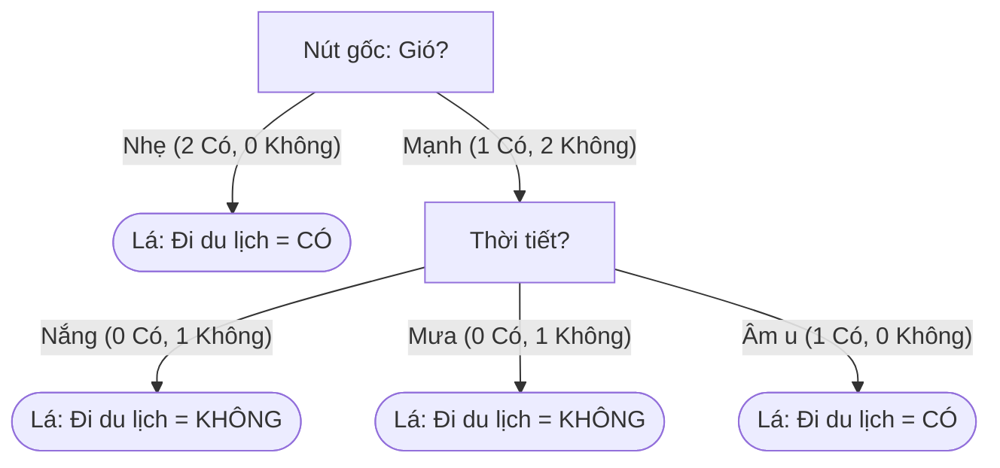

# Giải Chi Tiết Tự Luận, Bài Toán Tính Tay & Code Python Học Máy
**Tài liệu giải chi tiết 100% bài tập tự luận lý thuyết, bài tập tính tay từng bước và bài tập lập trình Python trong `Bai_tap_Hoc_may_v6_Image.pdf` & Slide bài giảng (ĐH Thủy Lợi).**

---

## Chương 2: Hồi Quy Tuyến Tính, Quá Khớp & Regularization

### Câu `2.21`: Khái niệm Overfitting và Underfitting & Cách nhận biết qua Training/Test Error
* **Overfitting (Quá khớp):**
  * **Khái niệm:** Là hiện tượng mô hình quá phức tạp (quá nhiều tham số hoặc bậc đa thức quá cao), dẫn đến việc học thuộc lòng cả các chi tiết ngẫu nhiên và **nhiễu (noise)** trong tập huấn luyện nhưng lại mất khả năng tổng quát hóa trên dữ liệu mới.
  * **Dấu hiệu nhận biết:** `Training error` **rất thấp** (gần bằng $0$), nhưng `Validation error` và `Test error` lại **rất cao** (khoảng cách giữa test error và training error lớn).
* **Underfitting (Chưa khớp / Dưới khớp):**
  * **Khái niệm:** Là hiện tượng mô hình quá đơn giản (ví dụ dùng đường thẳng bậc 1 để khớp dữ liệu có quy luật bậc 2, bậc 3), không đủ khả năng nắm bắt quy luật cơ bản của dữ liệu.
  * **Dấu hiệu nhận biết:** Cả `Training error` và `Test error` **đều cao**.

### Câu `2.22`: Nguyên lý hoạt động của K-Fold Cross Validation
1. **Bước 1 (Chia dữ liệu):** Trộn ngẫu nhiên tập dữ liệu huấn luyện $D$ và chia đều thành $K$ tập con (gọi là các *folds*) rời nhau có kích thước xấp xỉ bằng nhau: $D_1, D_2, \dots, D_K$ (thường chọn $K = 5$ hoặc $K = 10$).
2. **Bước 2 (Lặp huấn luyện & kiểm định):** Thực hiện $K$ lần lặp. Ở lần lặp thứ $i$ ($i = 1, \dots, K$):
   * Giữ lại fold $D_i$ làm tập kiểm định (**Validation set**).
   * Gộp $K-1$ folds còn lại làm tập huấn luyện (**Training set**).
   * Huấn luyện mô hình trên $K-1$ folds và tính sai số $E_i$ trên fold $D_i$.
3. **Bước 3 (Tổng hợp):** Hiệu năng/sai số tổng thể của mô hình được tính bằng trung bình cộng qua $K$ lần lặp:
   $$E_{\text{CV}} = \frac{1}{K} \sum_{i=1}^K E_i$$

### Câu `2.23`: Kỹ thuật Early Stopping & Vì sao được xem là Regularization?
* **Cơ chế hoạt động của Early Stopping:** Trong quá trình huấn luyện mô hình bằng các thuật toán lặp (như Gradient Descent), sau mỗi epoch ta đánh giá sai số trên cả tập `Training` và tập `Validation`. Ban đầu cả hai sai số cùng giảm, nhưng đến một thời điểm mô hình bắt đầu học vào nhiễu khiến `Validation error` quay đầu tăng lên (trong khi `Training error` vẫn tiếp tục giảm). **Early Stopping** dừng ngay quá trình huấn luyện tại điểm `Validation error` đạt cực tiểu và lưu lại bộ trọng số tại thời điểm đó.
* **Vì sao Early Stopping được xem là một phương pháp Regularization?**
  * Mục tiêu của Regularization là hạn chế độ phức tạp hiệu dụng của mô hình (giới hạn miền giá trị của trọng số $w$) để chống Overfitting.
  * Khi khởi tạo trọng số $w$ nhỏ (gần $0$) và cập nhật từng bước bằng Gradient Descent, số bước lặp càng ít thì độ lớn $\|w\|$ càng bị giới hạn trong một vùng lân cận nhỏ quanh điểm xuất phát (tương đương với hiệu ứng co trọng số của chuẩn $L_2$ - Ridge Regularization). Do đó, dừng sớm ngăn không cho trọng số phát triển quá lớn để khớp vào nhiễu.

### Câu `2.24`: So sánh LASSO Regularization ($L_1$) và RIDGE Regularization ($L_2$)

| Tiêu chí so sánh | RIDGE Regularization ($L_2$) | LASSO Regularization ($L_1$) |
| :--- | :--- | :--- |
| **1. Công thức hàm mất mát** | $J(w) = \frac{1}{2N}\sum_{i=1}^N (y_i - w^T \bar{x}_i)^2 + \lambda \|w\|_2^2$<br/>$= L_{\text{MSE}}(w) + \lambda \sum_{j=1}^d w_j^2$ | $J(w) = \frac{1}{2N}\sum_{i=1}^N (y_i - w^T \bar{x}_i)^2 + \lambda \|w\|_1$<br/>$= L_{\text{MSE}}(w) + \lambda \sum_{j=1}^d |w_j|$ |
| **2. Cơ chế hoạt động** | Phạt theo tổng bình phương các trọng số. Đạo hàm của thành phần phạt là $2\lambda w_j$, kéo các trọng số **co nhỏ về gần $0$** theo tỷ lệ nhưng **không bao giờ chạm đúng $0$** (trừ khi $\lambda \to \infty$). | Phạt theo tổng trị tuyệt đối các trọng số. Miền ràng buộc $\|w\|_1 \le t$ có các góc nhọn nằm trên các trục tọa độ, giúp ép các trọng số ít quan trọng **bằng $0$ tuyệt đối** ($w_j = 0$). |
| **3. Khả năng lựa chọn đặc trưng** | **Không có** khả năng loại bỏ đặc trưng (mọi đặc trưng vẫn giữ trọng số khác $0$ trong mô hình). | **Có khả năng lựa chọn đặc trưng tự động (Feature Selection)**, tạo ra mô hình thưa (*sparse model*). |
| **4. Trường hợp sử dụng phù hợp** | Khi hầu hết các biến đầu vào đều đóng góp vào kết quả dự báo, hoặc khi các biến đầu vào bị **đa cộng tuyến (tương quan mạnh với nhau)**. | Khi dữ liệu có số chiều rất lớn ($d$ lớn) nhưng nghi ngờ chỉ có một số ít đặc trưng thực sự quan trọng, cần lọc bỏ đặc trưng thừa và tăng tính diễn giải. |

### Câu `2.25`: Code Python Hồi quy tuyến tính (Đánh giá qua $R^2$, NSE, MAE, RMSE)
```python
import numpy as np
from sklearn.datasets import fetch_california_housing
from sklearn.model_selection import train_test_split
from sklearn.preprocessing import StandardScaler
from sklearn.linear_model import LinearRegression, Ridge, Lasso
from sklearn.metrics import r2_score, mean_absolute_error, mean_squared_error

# Hàm tính chỉ số Nash-Sutcliffe Efficiency (NSE)
def nse_score(y_true, y_pred):
    numerator = np.sum((y_true - y_pred) ** 2)
    denominator = np.sum((y_true - np.mean(y_true)) ** 2)
    return 1.0 - (numerator / denominator)

# 1. Tải dữ liệu (hoặc tạo dữ liệu giả lập điểm thi / giá nhà)
np.random.seed(42)
X = np.random.uniform(1, 10, size=(200, 3)) # 3 đặc trưng: số giờ học, điểm chuyên cần, số đề đã giải
y = 1.5 * X[:, 0] + 0.8 * X[:, 1] + 0.5 * X[:, 2] + 2.0 + np.random.normal(0, 0.5, 200)

X_train, X_test, y_train, y_test = train_test_split(X, y, test_size=0.2, random_state=42)

scaler = StandardScaler()
X_train_scaled = scaler.fit_transform(X_train)
X_test_scaled = scaler.transform(X_test)

# 2. Huấn luyện và so sánh Linear, Ridge, Lasso
models = {
    "Linear Regression": LinearRegression(),
    "Ridge (alpha=1.0)": Ridge(alpha=1.0),
    "Lasso (alpha=0.05)": Lasso(alpha=0.05)
}

for name, model in models.items():
    model.fit(X_train_scaled, y_train)
    y_pred = model.predict(X_test_scaled)
    r2 = r2_score(y_test, y_pred)
    nse = nse_score(y_test, y_pred)
    mae = mean_absolute_error(y_test, y_pred)
    rmse = np.sqrt(mean_squared_error(y_test, y_pred))
    print(f"=== {name} ===")
    print(f"  R2   = {r2:.4f} | NSE  = {nse:.4f}")
    print(f"  MAE  = {mae:.4f} | RMSE = {rmse:.4f}\n")
```

---

## Chương 3: Gradient Descent & Thuật Toán Perceptron (PLA)

### Câu `3.21` – `3.25`: Tự luận Lý thuyết Chương 3
* **Câu `3.21` (Ý tưởng GD):**
  * **Tại sao đi ngược hướng gradient?** Vector gradient $\nabla L(w)$ chỉ hướng mà hàm mất mát $L(w)$ **tăng nhanh nhất**. Vì mục tiêu của ta là tìm điểm **cực tiểu** của hàm mất mát, ta phải cập nhật trọng số theo hướng ngược lại: $w \leftarrow w - \eta \nabla L(w)$.
  * **Vai trò của Learning rate $\eta$:** Là bước nhảy xác định độ lớn của mỗi lần cập nhật tham số dọc theo hướng ngược gradient.
  * **Điều kiện dừng:** Khi $\|\nabla L(w)\| < \epsilon$ (đạo hàm xấp xỉ $0$), hoặc $|L(w^{(t+1)}) - L(w^{(t)})| < \epsilon$, hoặc đạt số vòng lặp tối đa.
* **Câu `3.22` (So sánh BGD, SGD, MBGD):** Xem bảng so sánh đầy đủ tại **Chương 3 - Mục 2** trong file `Tai_lieu_On_tap_Ly_thuyet_Hoc_May.md`.
* **Câu `3.23` (Ảnh hưởng của Learning Rate $\eta$):**
  * **Quá nhỏ** (VD: $\eta = 10^{-7}$): Bước đi cực nhỏ, hội tụ rất chậm, tốn tài nguyên và dễ bị mắc kẹt tại các điểm cực tiểu địa phương nông.
  * **Quá lớn** (VD: $\eta = 1.5$ cho hàm $f(x)=x^2$): Bước nhảy vọt qua bên kia thung lũng cực tiểu làm hàm mất mát dao động mạnh hoặc tăng vọt ra vô cùng (phân kỳ).
  * **Hợp lý** (VD: $\eta = 0.1$ hoặc $0.2$ cho hàm $f(x)=(x-2)^2+1$): Giá trị hàm mất mát giảm đều đặn sau mỗi bước và hội tụ nhanh chóng về điểm tối ưu $x^* = 2$.
* **Câu `3.24` (Nguyên lý Perceptron - PLA):**
  * **Bài toán:** Phân lớp nhị phân ($y \in \{-1, +1\}$) cho dữ liệu phân tách tuyến tính.
  * **Siêu phẳng phân tách:** Phương trình $w^T x + b = 0$ (hoặc $w^T \bar{x} = 0$ khi đã gộp bias vào vector $x$) chia không gian đặc trưng thành 2 nửa không gian ứng với 2 lớp $+1$ và $-1$.
  * **Dự đoán nhãn mẫu mới:** $\hat{y} = \text{sgn}(w^T x) = +1$ nếu $w^T x \ge 0$, và $-1$ nếu $w^T x < 0$.
  * **Quy tắc cập nhật trọng số:** Với mỗi điểm $(x_i, y_i)$ bị phân lớp sai ($y_i w^T x_i \le 0$), cập nhật: $w \leftarrow w + \eta y_i x_i$ (thường lấy $\eta = 1 \implies w \leftarrow w + y_i x_i$).
* **Câu `3.25` (Các độ đo đánh giá phân lớp & Bài toán phát hiện bệnh/gian lận):**
  * Công thức: $\text{Accuracy} = \frac{TP+TN}{TP+TN+FP+FN}$, $\text{Precision} = \frac{TP}{TP+FP}$, $\text{Recall} = \frac{TP}{TP+FN}$, $F_1 = \frac{2 \cdot \text{Precision} \cdot \text{Recall}}{\text{Precision} + \text{Recall}}$.
  * **Tại sao trong phát hiện bệnh hoặc gian lận giao dịch, Recall và $F_1$-score quan trọng hơn Accuracy?**
    * Vì dữ liệu trong các bài toán này **mất cân bằng cực độ** (ví dụ: $99.9\%$ giao dịch hợp lệ, chỉ $0.1\%$ là gian lận). Một mô hình đoán tất cả đều "bình thường" sẽ đạt $\text{Accuracy} = 99.9\%$ nhưng hoàn toàn vô dụng ($\text{Recall} = 0\%$).
    * Hơn nữa, hậu quả của việc **bỏ sót (False Negative - FN)** một bệnh nhân ung thư hoặc một vụ gian lận tài chính là cực kỳ nghiêm trọng. Do đó, ta ưu tiên tối đa hóa **Recall** (để không bỏ sót ca dương tính nào) và dùng **$F_1$-score** để cân bằng giữa việc bắt trúng bệnh/gian lận (Recall) và tránh báo động giả quá nhiều (Precision).

---

### Câu `3.26` (Tính tay Gradient Descent)
**Đề bài:** Cho hàm số $f(x) = x^2 - 4x + 5$. Thực hiện Gradient Descent với điểm khởi tạo $x^{(0)} = 5$, learning rate $\eta = 0.2$.

**Lời giải chi tiết:**
1. **Tính đạo hàm $f'(x)$:**
   $$f'(x) = \frac{d}{dx}(x^2 - 4x + 5) = 2x - 4$$
   *(Lưu ý: Nghiệm cực tiểu thực sự của hàm số là $f'(x) = 0 \iff 2x - 4 = 0 \iff x^* = 2$, với giá trị cực tiểu $f(2) = 2^2 - 4(2) + 5 = 1$).*

2. **Thực hiện 4 bước cập nhật & Tính giá trị hàm số tại mỗi bước:**
   Công thức cập nhật:
   $$x^{(k)} = x^{(k-1)} - \eta f'(x^{(k-1)}) = x^{(k-1)} - 0.2 \cdot (2x^{(k-1)} - 4)$$
   * **Tại bước khởi tạo ($k = 0$):**
     * $x^{(0)} = 5$
     * $f(x^{(0)}) = 5^2 - 4(5) + 5 = 25 - 20 + 5 = \mathbf{10}$
     * $f'(x^{(0)}) = 2(5) - 4 = 6$
   * **Bước cập nhật 1 ($k = 1$):**
     * $x^{(1)} = x^{(0)} - 0.2 \cdot f'(x^{(0)}) = 5 - 0.2 \times 6 = 5 - 1.2 = \mathbf{3.8}$
     * $f(x^{(1)}) = (3.8)^2 - 4(3.8) + 5 = 14.44 - 15.2 + 5 = \mathbf{4.24}$
     * $f'(x^{(1)}) = 2(3.8) - 4 = 3.6$
   * **Bước cập nhật 2 ($k = 2$):**
     * $x^{(2)} = x^{(1)} - 0.2 \cdot f'(x^{(1)}) = 3.8 - 0.2 \times 3.6 = 3.8 - 0.72 = \mathbf{3.08}$
     * $f(x^{(2)}) = (3.08)^2 - 4(3.08) + 5 = 9.4864 - 12.32 + 5 = \mathbf{2.1664}$
     * $f'(x^{(2)}) = 2(3.08) - 4 = 2.16$
   * **Bước cập nhật 3 ($k = 3$):**
     * $x^{(3)} = x^{(2)} - 0.2 \cdot f'(x^{(2)}) = 3.08 - 0.2 \times 2.16 = 3.08 - 0.432 = \mathbf{2.648}$
     * $f(x^{(3)}) = (2.648)^2 - 4(2.648) + 5 = 7.011904 - 10.592 + 5 = \mathbf{1.419904}$
     * $f'(x^{(3)}) = 2(2.648) - 4 = 1.296$
   * **Bước cập nhật 4 ($k = 4$):**
     * $x^{(4)} = x^{(3)} - 0.2 \cdot f'(x^{(3)}) = 2.648 - 0.2 \times 1.296 = 2.648 - 0.2592 = \mathbf{2.3888}$
     * $f(x^{(4)}) = (2.3888)^2 - 4(2.3888) + 5 = 5.706365 - 9.5552 + 5 = \mathbf{1.151165}$

| Bước $k$ | $x^{(k)}$ | Đạo hàm $f'(x^{(k)}) = 2x^{(k)} - 4$ | Giá trị hàm $f(x^{(k)})$ |
| :---: | :---: | :---: | :---: |
| $0$ | $5.0000$ | $6.0000$ | $10.0000$ |
| $1$ | $3.8000$ | $3.6000$ | $4.2400$ |
| $2$ | $3.0800$ | $2.1600$ | $2.1664$ |
| $3$ | $2.6480$ | $1.2960$ | $1.4199$ |
| $4$ | $2.3888$ | $0.7776$ | $1.1512$ |

3. **Nhận xét sự hội tụ của thuật toán:**
   * Qua mỗi bước lặp, $x^{(k)}$ giảm đơn điệu ($5 \to 3.8 \to 3.08 \to 2.648 \to 2.3888$) và tiến dần về điểm cực tiểu toàn cục $x^* = 2$.
   * Giá trị hàm số $f(x^{(k)})$ giảm mạnh và liên tục ($10 \to 4.24 \to 2.1664 \to 1.4199 \to 1.1512$) tiến sát về giá trị cực tiểu $f(2) = 1$.
   * Độ lớn đạo hàm $|f'(x^{(k)})|$ giảm dần về $0$, nên bước nhảy nhỏ dần khi đến gần cực tiểu — thuật toán **hội tụ ổn định và nhanh chóng** với $\eta = 0.2$.

---

### Câu `3.27` (Tính tay Perceptron)
**Đề bài:** Cho $w = [1, 2, -10]^T$, $x = [3, 4, 1]^T$ (đã thêm bias).
1. **Tính $w^T x$:**
   $$w^T x = 1 \times 3 + 2 \times 4 + (-10) \times 1 = 3 + 8 - 10 = \mathbf{1}$$
2. **Xác định nhãn dự đoán của điểm dữ liệu:**
   Vì $w^T x = 1 > 0$, nhãn dự đoán là:
   $$\hat{y} = \text{sgn}(w^T x) = \text{sgn}(1) = \mathbf{+1}$$
3. **Nếu nhãn thực tế là $y = -1$, điểm dữ liệu có bị phân lớp sai không?**
   * Nhãn dự đoán $\hat{y} = +1 \neq y = -1$ (hoặc kiểm tra điều kiện $y \cdot (w^T x) = (-1) \times 1 = -1 < 0$).
   * **Kết luận:** Điểm dữ liệu **BỊ PHÂN LỚP SAI**.

---

### Câu `3.28` (Tính tay cập nhật Perceptron)
**Đề bài:** Cho $w = [-2, 1, 0]^T$, $x = [2, 3, 1]^T$, $y = 1$ (trong đó $x$ đã thêm bias).
1. **Kiểm tra mẫu có bị phân lớp sai hay không:**
   $$w^T x = (-2) \times 2 + 1 \times 3 + 0 \times 1 = -4 + 3 + 0 = -1$$
   Vì $w^T x = -1 < 0 \implies \hat{y} = \text{sgn}(-1) = -1 \neq y = 1$ (hay $y(w^T x) = -1 < 0$).
   $\implies$ Mẫu dữ liệu **bị phân lớp sai**.
2. **Thực hiện một bước cập nhật Perceptron (với $\eta = 1$):**
   $$w_{\text{mới}} = w + y \cdot x = \begin{bmatrix} -2 \\ 1 \\ 0 \end{bmatrix} + (1) \cdot \begin{bmatrix} 2 \\ 3 \\ 1 \end{bmatrix} = \begin{bmatrix} -2 + 2 \\ 1 + 3 \\ 0 + 1 \end{bmatrix} = \mathbf{\begin{bmatrix} 0 \\ 4 \\ 1 \end{bmatrix}}$$
3. **Tính lại giá trị $w_{\text{mới}}^T x$ sau cập nhật:**
   $$w_{\text{mới}}^T x = 0 \times 2 + 4 \times 3 + 1 \times 1 = 0 + 12 + 1 = \mathbf{13}$$
   *(Nhận xét: Giá trị $w^T x$ đã đổi dấu từ $-1$ sang $+13 > 0$, giúp mẫu $x$ được dự đoán đúng thành nhãn $\hat{y} = +1 = y$!).*

---

### Câu `3.29` & `3.30`: Code Python Xây dựng lớp `Perceptron` & Phân lớp nhị phân
```python
import numpy as np
from sklearn.datasets import make_classification
from sklearn.model_selection import train_test_split
from sklearn.metrics import accuracy_score, precision_score, recall_score, f1_score

class Perceptron:
    def __init__(self, lr=1.0, max_epochs=1000):
        self.lr = lr
        self.max_epochs = max_epochs
        self.w = None

    def _add_bias(self, X):
        # Ghép cột 1 vào cuối mỗi mẫu x -> [x_1, ..., x_d, 1]
        return np.c_[X, np.ones(X.shape[0])]

    def fit(self, X, y):
        # Chuyển nhãn về {-1, +1}
        y_ = np.where(y <= 0, -1, 1)
        X_bar = self._add_bias(X)
        self.w = np.zeros(X_bar.shape[1])

        for _ in range(self.max_epochs):
            misclassified = 0
            for xi, yi in zip(X_bar, y_):
                if yi * np.dot(self.w, xi) <= 0:
                    self.w += self.lr * yi * xi
                    misclassified += 1
            if misclassified == 0:
                break
        return self

    def predict(self, X):
        X_bar = self._add_bias(X)
        preds = np.sign(np.dot(X_bar, self.w))
        return np.where(preds >= 0, 1, 0)

# Thực hành Câu 3.30: Phân loại giao dịch gian lận giả lập
X, y = make_classification(n_samples=500, n_features=4, n_Redundant=0,
                           n_informative=4, class_sep=1.5, random_state=42)
X_train, X_test, y_train, y_test = train_test_split(X, y, test_size=0.2, random_state=42)

pla = Perceptron(lr=0.1, max_epochs=500).fit(X_train, y_train)
y_pred = pla.predict(X_test)

print(f"Accuracy : {accuracy_score(y_test, y_pred):.4f}")
print(f"Precision: {precision_score(y_test, y_pred):.4f}")
print(f"Recall   : {recall_score(y_test, y_pred):.4f}")
print(f"F1-score : {f1_score(y_test, y_pred):.4f}")
```

---

## Chương 4: Mạng Nơ-ron Nhân Tạo (ANN / MLP)

### Câu `4.21` – `4.23`: Tự luận Lý thuyết Chương 4
* **Câu `4.21` (Cấu trúc MLP & Khả năng học phi tuyến):**
  * **Input Layer:** Tiếp nhận các đặc trưng thô $x_1, \dots, x_d$ của dữ liệu.
  * **Hidden Layer (Tầng ẩn):** Thực hiện phép biến đổi tuyến tính $z = Wx + b$ kết hợp với hàm kích hoạt phi tuyến $\sigma(z)$ để trích xuất các đặc trưng ẩn bậc cao.
  * **Output Layer:** Tổng hợp các đặc trưng từ tầng ẩn cuối cùng để đưa ra giá trị dự đoán $\hat{y}$ (số thực cho hồi quy, hoặc xác suất qua Sigmoid/Softmax cho phân lớp).
  * **Tại sao mạng nhiều tầng học được quan hệ phi tuyến phức tạp?** Nhờ việc xếp chồng nhiều tầng ẩn có **hàm kích hoạt phi tuyến** (như ReLU, Sigmoid, Tanh). Theo Định lý xấp xỉ phổ quát (*Universal Approximation Theorem*), tổ hợp các hàm phi tuyến lồng nhau cho phép mạng uốn cong không gian quyết định để xấp xỉ bất kỳ hàm liên tục phức tạp nào.
* **Câu `4.22` (Lan truyền xuôi - Forward Propagation):**
  * Là quá trình truyền tín hiệu từ tầng đầu vào qua lần lượt các tầng ẩn đến tầng đầu ra: Với mỗi tầng $l = 1, \dots, L$, tính tổng tuyến tính $z^{(l)} = W^{(l)} a^{(l-1)} + b^{(l)}$ (với $a^{(0)} = x$), sau đó áp dụng hàm kích hoạt $a^{(l)} = f^{(l)}(z^{(l)})$. Kết quả ở tầng cuối $a^{(L)} = \hat{y}$ là đầu ra dự đoán của mạng.
* **Câu `4.23` (Lan truyền ngược - Backpropagation):**
  * Sau khi tính hàm mất mát $J(y, \hat{y})$ ở cuối bước lan truyền xuôi, **Backpropagation** sử dụng quy tắc đạo hàm hàm hợp (*Chain Rule*) để truyền ngược sai số từ tầng `Output` về các tầng `Hidden` nhằm tính chính xác đạo hàm riêng (Gradient) $\frac{\partial J}{\partial W^{(l)}}$ và $\frac{\partial J}{\partial b^{(l)}}$.
  * **Gradient:** Vector/ma trận đạo hàm chỉ hướng tăng nhanh nhất của hàm mất mát $J$.
  * **Gradient Descent:** Dùng gradient vừa tính để cập nhật trọng số ngược hướng gradient: $W^{(l)} \leftarrow W^{(l)} - \eta \frac{\partial J}{\partial W^{(l)}}$.
  * **Learning Rate ($\eta$):** Hệ số kiểm soát độ lớn bước cập nhật trọng số của mạng.

---

### Câu `4.24` & `4.25` (Tính tay Lan truyền xuôi & Lan truyền ngược Mạng Nơ-ron)
**Đề bài:** Cho mạng nơ-ron gồm:
* Tầng đầu vào: 2 nơ-ron, vector đầu vào $x = \begin{bmatrix} 1 \\ 2 \end{bmatrix}$, nhãn thật $y = 5$.
* 1 tầng ẩn: 2 nơ-ron, ma trận trọng số $W^{(1)} = \begin{bmatrix} 1 & 0 \\ 0 & 1 \end{bmatrix}$.
* Tầng đầu ra: 1 nơ-ron, ma trận trọng số $W^{(2)} = \begin{bmatrix} 1 & 1 \end{bmatrix}$.
* Hàm kích hoạt là $\text{ReLU}(z) = \max(0, z)$, không có bias. Hàm mất mát $J = \frac{1}{2}(y - \hat{y})^2$.

#### Lời giải Câu `4.24` (Lan truyền xuôi):
1. **Tính tổng tuyến tính tại tầng ẩn $z^{(1)}$:**
   $$z^{(1)} = W^{(1)} x = \begin{bmatrix} 1 & 0 \\ 0 & 1 \end{bmatrix} \begin{bmatrix} 1 \\ 2 \end{bmatrix} = \mathbf{\begin{bmatrix} 1 \\ 2 \end{bmatrix}}$$
2. **Tính đầu ra sau hàm kích hoạt ReLU tại tầng ẩn $a^{(1)}$:**
   $$a^{(1)} = \text{ReLU}(z^{(1)}) = \begin{bmatrix} \max(0, 1) \\ \max(0, 2) \end{bmatrix} = \mathbf{\begin{bmatrix} 1 \\ 2 \end{bmatrix}}$$
3. **Tính tổng tuyến tính tại tầng đầu ra $z^{(2)}$:**
   $$z^{(2)} = W^{(2)} a^{(1)} = \begin{bmatrix} 1 & 1 \end{bmatrix} \begin{bmatrix} 1 \\ 2 \end{bmatrix} = 1 \times 1 + 1 \times 2 = \mathbf{3}$$
4. **Đầu ra cuối cùng của mạng $\hat{y}$:**
   $$\hat{y} = a^{(2)} = \text{ReLU}(z^{(2)}) = \max(0, 3) = \mathbf{3}$$

#### Lời giải Câu `4.25` (Lan truyền ngược tính $\frac{\partial J}{\partial W^{(2)}}$ và $\frac{\partial J}{\partial W^{(1)}}$):
1. **Giá trị hàm mất mát hiện tại:**
   $$J = \frac{1}{2}(y - \hat{y})^2 = \frac{1}{2}(5 - 3)^2 = 2$$
2. **Tính đạo hàm sai số tại tầng đầu ra $\delta^{(2)}$:**
   * Đạo hàm của $J = \frac{1}{2}(\hat{y} - y)^2$ theo $\hat{y}$:
     $$\frac{\partial J}{\partial \hat{y}} = \hat{y} - y = 3 - 5 = -2$$
   * Vì $z^{(2)} = 3 > 0$, đạo hàm $\text{ReLU}'(z^{(2)}) = 1$. Do đó:
     $$\delta^{(2)} = \frac{\partial J}{\partial z^{(2)}} = \frac{\partial J}{\partial \hat{y}} \cdot \text{ReLU}'(z^{(2)}) = -2 \times 1 = \mathbf{-2}$$
3. **Tính Gradient đối với trọng số tầng 2 ($\frac{\partial J}{\partial W^{(2)}}$ - Câu `4.20`):**
   $$\frac{\partial J}{\partial W^{(2)}} = \delta^{(2)} \cdot (a^{(1)})^T = (-2) \cdot \begin{bmatrix} 1 & 2 \end{bmatrix} = \mathbf{\begin{bmatrix} -2 & -4 \end{bmatrix}}$$
4. **Truyền ngược sai số về tầng ẩn 1 ($\delta^{(1)}$):**
   * Vì $z^{(1)} = \begin{bmatrix} 1 \\ 2 \end{bmatrix}$ có cả hai phần tử đều $> 0$, nên đạo hàm $\text{ReLU}'(z^{(1)}) = \begin{bmatrix} 1 \\ 1 \end{bmatrix}$.
   * Vector sai số tại tầng ẩn 1:
     $$\delta^{(1)} = \frac{\partial J}{\partial z^{(1)}} = \left((W^{(2)})^T \delta^{(2)}\right) \odot \text{ReLU}'(z^{(1)}) = \begin{bmatrix} 1 \\ 1 \end{bmatrix} (-2) \odot \begin{bmatrix} 1 \\ 1 \end{bmatrix} = \mathbf{\begin{bmatrix} -2 \\ -2 \end{bmatrix}}$$
5. **Tính Gradient đối với trọng số tầng 1 ($\frac{\partial J}{\partial W^{(1)}}$):**
   $$\frac{\partial J}{\partial W^{(1)}} = \delta^{(1)} \cdot x^T = \begin{bmatrix} -2 \\ -2 \end{bmatrix} \begin{bmatrix} 1 & 2 \end{bmatrix} = \mathbf{\begin{bmatrix} -2 & -4 \\ -2 & -4 \end{bmatrix}}$$

---

### Câu `4.26` – `4.28`: Code Python Huấn luyện Mạng Nơ-ron đa tầng từ đầu (MLP from Scratch)
```python
import numpy as np

class MLPFromScratch:
    """Mạng Nơ-ron đa tầng (MLP) với số tầng ẩn và số nơ-ron tùy ý."""
    def __init__(self, layer_sizes, task='regression', lr=0.01, epochs=500):
        # layer_sizes: list số nơ-ron mỗi tầng, VD: [n_inputs, 16, 8, n_outputs]
        self.layer_sizes = layer_sizes
        self.task = task
        self.lr = lr
        self.epochs = epochs
        self.weights = []
        self.biases = []
        np.random.seed(42)
        for i in range(len(layer_sizes) - 1):
            # Khởi tạo He initialization cho ReLU
            W = np.random.randn(layer_sizes[i], layer_sizes[i + 1]) * np.sqrt(2.0 / layer_sizes[i])
            b = np.zeros((1, layer_sizes[i + 1]))
            self.weights.append(W)
            self.biases.append(b)

    def _relu(self, z):
        return np.maximum(0, z)

    def _relu_deriv(self, z):
        return (z > 0).astype(float)

    def _sigmoid(self, z):
        return 1.0 / (1.0 + np.exp(-np.clip(z, -250, 250)))

    def forward(self, X):
        activations = [X]
        zs = []
        A = X
        L = len(self.weights)
        for l in range(L):
            Z = np.dot(A, self.weights[l]) + self.biases[l]
            zs.append(Z)
            if l < L - 1:
                A = self._relu(Z)
            else:
                # Tầng cuối: tuyến tính cho hồi quy, sigmoid cho phân lớp nhị phân
                A = Z if self.task == 'regression' else self._sigmoid(Z)
            activations.append(A)
        return activations, zs

    def fit(self, X, y):
        y = y.reshape(-1, 1)
        N = X.shape[0]
        L = len(self.weights)
        for _ in range(self.epochs):
            activations, zs = self.forward(X)
            y_hat = activations[-1]
            # Sai số tại tầng đầu ra (chung dạng cho cả MSE + Linear và BCE + Sigmoid)
            delta = (y_hat - y) / N
            for l in range(L - 1, -1, -1):
                dW = np.dot(activations[l].T, delta)
                db = np.sum(delta, axis=0, keepdims=True)
                if l > 0:
                    delta = np.dot(delta, self.weights[l].T) * self._relu_deriv(zs[l - 1])
                self.weights[l] -= self.lr * dW
                self.biases[l] -= self.lr * db
        return self

    def predict(self, X):
        activations, _ = self.forward(X)
        y_hat = activations[-1]
        if self.task == 'regression':
            return y_hat.ravel()
        return (y_hat.ravel() >= 0.5).astype(int)
```

---

## Chương 5: Phương Pháp Học Theo Mô Hình Cây (ID3 & CART)

### Câu `5.21` (Tính tay ID3 trên bảng dữ liệu "Đi du lịch" - 5 mẫu)
**Đề bài:** Cho tập dữ liệu $S$ gồm $N = 5$ mẫu về việc có nên đi du lịch hay không:

| STT | Thời tiết | Gió | Đi du lịch (Nhãn $y$) |
| :---: | :--- | :--- | :--- |
| 1 | Nắng | Mạnh | Không |
| 2 | Nắng | Nhẹ | Có |
| 3 | Mưa | Mạnh | Không |
| 4 | Mưa | Nhẹ | Có |
| 5 | Âm u | Mạnh | Có |

#### a) Tính Entropy của toàn bộ tập dữ liệu $S$:
* Trong $5$ mẫu của tập $S$, có:
  * Lớp `Có`: $3$ mẫu $\implies p_{\text{Có}} = \frac{3}{5} = 0.6$
  * Lớp `Không`: $2$ mẫu $\implies p_{\text{Không}} = \frac{2}{5} = 0.4$
* **Entropy của toàn tập $S$** (tính theo cơ số 2, đơn vị bit):
  $$H(S) = -\frac{3}{5}\log_2\left(\frac{3}{5}\right) - \frac{2}{5}\log_2\left(\frac{2}{5}\right) = -0.6(-0.7370) - 0.4(-1.3219) \approx 0.4422 + 0.5288 = \mathbf{0.9710\text{ bit}}$$
  *(Nếu tính theo logarit tự nhiên $\ln$ như trong slide bài giảng: $H(S) = -0.6\ln(0.6) - 0.4\ln(0.4) \approx \mathbf{0.6730\text{ nat}}$).*

#### b) Tính Information Gain cho từng thuộc tính:
1. **Xét thuộc tính `Thời tiết`:** Có 3 giá trị $\{\text{Nắng}, \text{Mưa}, \text{Âm u}\}$:
   * Nhánh $\text{Thời tiết} = \text{Nắng}$ ($|S_{\text{Nắng}}| = 2$ mẫu: 1 `Có`, 1 `Không`):
     $$H(S_{\text{Nắng}}) = -\frac{1}{2}\log_2\left(\frac{1}{2}\right) - \frac{1}{2}\log_2\left(\frac{1}{2}\right) = \mathbf{1.0\text{ bit}} \quad (\text{theo }\ln: 0.6931)$$
   * Nhánh $\text{Thời tiết} = \text{Mưa}$ ($|S_{\text{Mưa}}| = 2$ mẫu: 1 `Có`, 1 `Không`):
     $$H(S_{\text{Mưa}}) = -\frac{1}{2}\log_2\left(\frac{1}{2}\right) - \frac{1}{2}\log_2\left(\frac{1}{2}\right) = \mathbf{1.0\text{ bit}} \quad (\text{theo }\ln: 0.6931)$$
   * Nhánh $\text{Thời tiết} = \text{Âm u}$ ($|S_{\text{Âm u}}| = 1$ mẫu: 1 `Có`, 0 `Không` — thuần khiết):
     $$H(S_{\text{Âm u}}) = \mathbf{0\text{ bit}}$$
   * **Entropy trung bình sau khi chia theo `Thời tiết`:**
     $$H(\text{Thời tiết}, S) = \frac{2}{5}(1.0) + \frac{2}{5}(1.0) + \frac{1}{5}(0) = \frac{4}{5} = \mathbf{0.8000\text{ bit}} \quad (\text{theo }\ln: 0.5545)$$
   * **Information Gain của `Thời tiết`:**
     $$\text{Gain}(S, \text{Thời tiết}) = H(S) - H(\text{Thời tiết}, S) = 0.9710 - 0.8000 = \mathbf{0.1710\text{ bit}} \quad (\text{theo }\ln: 0.1185)$$

2. **Xét thuộc tính `Gió`:** Có 2 giá trị $\{\text{Mạnh}, \text{Nhẹ}\}$:
   * Nhánh $\text{Gió} = \text{Mạnh}$ ($|S_{\text{Mạnh}}| = 3$ mẫu gồm STT 1, 3, 5: 1 `Có`, 2 `Không`):
     $$H(S_{\text{Mạnh}}) = -\frac{1}{3}\log_2\left(\frac{1}{3}\right) - \frac{2}{3}\log_2\left(\frac{2}{3}\right) \approx 0.5283 + 0.3900 = \mathbf{0.9183\text{ bit}} \quad (\text{theo }\ln: 0.6365)$$
   * Nhánh $\text{Gió} = \text{Nhẹ}$ ($|S_{\text{Nhẹ}}| = 2$ mẫu gồm STT 2, 4: 2 `Có`, 0 `Không` — thuần khiết):
     $$H(S_{\text{Nhẹ}}) = \mathbf{0\text{ bit}}$$
   * **Entropy trung bình sau khi chia theo `Gió`:**
     $$H(\text{Gió}, S) = \frac{3}{5}(0.9183) + \frac{2}{5}(0) = \mathbf{0.5510\text{ bit}} \quad (\text{theo }\ln: 0.3819)$$
   * **Information Gain của `Gió`:**
     $$\text{Gain}(S, \text{Gió}) = H(S) - H(\text{Gió}, S) = 0.9710 - 0.5510 = \mathbf{0.4200\text{ bit}} \quad (\text{theo }\ln: 0.2911)$$

#### c) Chọn nút gốc, phân nhánh tiếp và vẽ Cây quyết định ID3:
* Vì $\text{Gain}(S, \text{Gió}) = 0.4200 > \text{Gain}(S, \text{Thời tiết}) = 0.1710$, ID3 chọn thuộc tính **`Gió`** làm **Nút gốc (Root node)**:
  * **Nhánh `Gió = Nhẹ`** (2 mẫu đều là `Có`): Đã thuần khiết ($H = 0$) $\implies$ tạo nút lá **`Đi du lịch = Có`**.
  * **Nhánh `Gió = Mạnh`** (3 mẫu: STT 1 `(Nắng, Không)`, STT 3 `(Mưa, Không)`, STT 5 `(Âm u, Có)`): Chưa thuần khiết, chỉ còn thuộc tính **`Thời tiết`** để chia tiếp:
    * `Thời tiết = Nắng` (1 mẫu: `Không`) $\implies$ Nút lá **`Không`**.
    * `Thời tiết = Mưa` (1 mẫu: `Không`) $\implies$ Nút lá **`Không`**.
    * `Thời tiết = Âm u` (1 mẫu: `Có`) $\implies$ Nút lá **`Có`**.



---

### Bài Tập Bổ Sung Từ Slide (`Chapter_4.1_ID3.pdf` Trang 31 & Câu `5.22`): Tính tay ID3 & CART cho bảng "Mua máy tính" (14 mẫu)
Trong cả Slide Chương 4.1 (trang 31) và Sách bài tập (Câu `5.22`), bảng dữ liệu **"Mua máy tính" (`buys_computer`)** có $N = 14$ mẫu gồm $9$ mẫu `Có` (`yes`) và $5$ mẫu `Không` (`no`):
* **Entropy ban đầu của tập $S$:**
  $$H(S) = -\frac{9}{14}\log_2\left(\frac{9}{14}\right) - \frac{5}{14}\log_2\left(\frac{5}{14}\right) \approx \mathbf{0.9403\text{ bit}} \quad (\text{theo }\ln: 0.6518)$$
* **Tính Information Gain tại nút gốc cho 4 thuộc tính:**
  1. **`Tuổi` (`age`):**
     * `Trẻ` (5 mẫu: 2 Có, 3 Không) $\implies H = 0.9710\text{ bit}$.
     * `Trung niên` (4 mẫu: 4 Có, 0 Không) $\implies H = 0\text{ bit}$ (Thuần khiết!).
     * `Già` (5 mẫu: 3 Có, 2 Không) $\implies H = 0.9710\text{ bit}$.
     * $H(\text{Tuổi}, S) = \frac{5}{14}(0.9710) + \frac{4}{14}(0) + \frac{5}{14}(0.9710) = \mathbf{0.6936\text{ bit}} \implies \text{Gain}(S, \text{Tuổi}) = 0.9403 - 0.6936 = \mathbf{0.2467\text{ bit}}$.
  2. **`Thu nhập` (`income`):**
     * `Cao` (4 mẫu: 2 Có, 2 Không) $\implies H = 1.0\text{ bit}$.
     * `Trung bình` (6 mẫu: 4 Có, 2 Không) $\implies H = 0.9183\text{ bit}$.
     * `Thấp` (4 mẫu: 3 Có, 1 Không) $\implies H = 0.8113\text{ bit}$.
     * $H(\text{Thu nhập}, S) = \frac{4}{14}(1.0) + \frac{6}{14}(0.9183) + \frac{4}{14}(0.8113) = \mathbf{0.9111\text{ bit}} \implies \text{Gain}(S, \text{Thu nhập}) = 0.9403 - 0.9111 = \mathbf{0.0292\text{ bit}}$.
  3. **`Sinh viên` (`student`):**
     * `Có` (7 mẫu: 6 Có, 1 Không) $\implies H = 0.5917\text{ bit}$.
     * `Không` (7 mẫu: 3 Có, 4 Không) $\implies H = 0.9852\text{ bit}$.
     * $H(\text{Sinh viên}, S) = \frac{7}{14}(0.5917) + \frac{7}{14}(0.9852) = \mathbf{0.7885\text{ bit}} \implies \text{Gain}(S, \text{Sinh viên}) = 0.9403 - 0.7885 = \mathbf{0.1518\text{ bit}}$.
  4. **`Đánh giá tín dụng` (`credit_rating`):**
     * `Tốt` (`fair` - 8 mẫu: 6 Có, 2 Không) $\implies H = 0.8113\text{ bit}$.
     * `Xuất sắc` (`excellent` - 6 mẫu: 3 Có, 3 Không) $\implies H = 1.0\text{ bit}$.
     * $H(\text{Tín dụng}, S) = \frac{8}{14}(0.8113) + \frac{6}{14}(1.0) = \mathbf{0.8922\text{ bit}} \implies \text{Gain}(S, \text{Tín dụng}) = 0.9403 - 0.8922 = \mathbf{0.0481\text{ bit}}$.
* **Kết luận Cây ID3 cho bảng "Mua máy tính":**
  * Thuộc tính **`Tuổi`** có $\text{Gain} = 0.2467\text{ bit}$ lớn nhất nên được chọn làm **Nút gốc**:
    * Nhánh `Tuổi = Trung niên`: Nút lá **`Có`** (4/4 mẫu đều mua).
    * Nhánh `Tuổi = Trẻ` (5 mẫu: ID 1, 2, 8, 9, 11): Chia tiếp theo **`Sinh viên`** (`Không` $\to$ **`Không`**, `Có` $\to$ **`Có`**) đạt độ thuần khiết 100%!
    * Nhánh `Tuổi = Già` (5 mẫu: ID 4, 5, 6, 10, 14): Chia tiếp theo **`Đánh giá tín dụng`** (`Tốt` $\to$ **`Có`**, `Xuất sắc` $\to$ **`Không`**) đạt độ thuần khiết 100%!

---

### Câu `5.22` – `5.25`: Code Python Cài đặt ID3 từ đầu & Thực hành CART
```python
import numpy as np
import pandas as pd

# === CÂU 5.22: CÀI ĐẶT THUẬT TOÁN ID3 TỪ ĐẦU BẰNG PYTHON ===
data = [
    {"Tuổi": "Trẻ", "Thu nhập": "Cao", "Sinh viên": "Không", "Tín dụng": "Tốt", "Mua": "Không"},
    {"Tuổi": "Trẻ", "Thu nhập": "Cao", "Sinh viên": "Không", "Tín dụng": "Xuất sắc", "Mua": "Không"},
    {"Tuổi": "Trung niên", "Thu nhập": "Cao", "Sinh viên": "Không", "Tín dụng": "Tốt", "Mua": "Có"},
    {"Tuổi": "Già", "Thu nhập": "Trung bình", "Sinh viên": "Không", "Tín dụng": "Tốt", "Mua": "Có"},
    {"Tuổi": "Già", "Thu nhập": "Thấp", "Sinh viên": "Có", "Tín dụng": "Tốt", "Mua": "Có"},
    {"Tuổi": "Già", "Thu nhập": "Thấp", "Sinh viên": "Có", "Tín dụng": "Xuất sắc", "Mua": "Không"},
    {"Tuổi": "Trung niên", "Thu nhập": "Thấp", "Sinh viên": "Có", "Tín dụng": "Xuất sắc", "Mua": "Có"},
    {"Tuổi": "Trẻ", "Thu nhập": "Trung bình", "Sinh viên": "Không", "Tín dụng": "Tốt", "Mua": "Không"},
    {"Tuổi": "Trẻ", "Thu nhập": "Thấp", "Sinh viên": "Có", "Tín dụng": "Tốt", "Mua": "Có"},
    {"Tuổi": "Già", "Thu nhập": "Trung bình", "Sinh viên": "Có", "Tín dụng": "Tốt", "Mua": "Có"},
    {"Tuổi": "Trẻ", "Thu nhập": "Trung bình", "Sinh viên": "Có", "Tín dụng": "Xuất sắc", "Mua": "Có"},
    {"Tuổi": "Trung niên", "Thu nhập": "Trung bình", "Sinh viên": "Không", "Tín dụng": "Xuất sắc", "Mua": "Có"},
    {"Tuổi": "Trung niên", "Thu nhập": "Cao", "Sinh viên": "Có", "Tín dụng": "Tốt", "Mua": "Có"},
    {"Tuổi": "Già", "Thu nhập": "Trung bình", "Sinh viên": "Không", "Tín dụng": "Xuất sắc", "Mua": "Không"},
]
df = pd.DataFrame(data)

def entropy(y):
    _, counts = np.unique(y, return_counts=True)
    probs = counts / len(y)
    return -np.sum(probs * np.log2(probs))

def information_gain(df, feature, target="Mua"):
    total_H = entropy(df[target])
     weighted_H = 0.0
    for val, subset in df.groupby(feature):
        weighted_H += (len(subset) / len(df)) * entropy(subset[target])
    return total_H - weighted_H

def build_tree(df, features, target="Mua"):
    labels = df[target].values
    # Điều kiện dừng 1: Thuần khiết hoàn toàn
    if len(np.unique(labels)) == 1:
        return labels[0]
    # Điều kiện dừng 2: Hết thuộc tính để chia -> trả về nhãn đa số
    if len(features) == 0:
        vals, counts = np.unique(labels, return_counts=True)
        return vals[np.argmax(counts)]

    # Chọn thuộc tính có Information Gain lớn nhất
    gains = [information_gain(df, f, target) for f in features]
    best_feat = features[np.argmax(gains)]
    tree = {best_feat: {}}
    rem_features = [f for f in features if f != best_feat]

    for val, subset in df.groupby(best_feat):
        tree[best_feat][val] = build_tree(subset, rem_features, target)
    return tree

def predict(tree, sample, default="Có"):
    if not isinstance(tree, dict):
        return tree
    root_feat = next(iter(tree))
    val = sample.get(root_feat)
    if val not in tree[root_feat]:
        return default
    return predict(tree[root_feat][val], sample, default)

features = ["Tuổi", "Thu nhập", "Sinh viên", "Tín dụng"]
id3_tree = build_tree(df, features, target="Mua")
print("Cây quyết định ID3:", id3_tree)
test_sample = {"Tuổi": "Trẻ", "Thu nhập": "Thấp", "Sinh viên": "Có", "Tín dụng": "Tốt"}
print("Dự đoán cho mẫu thử:", predict(id3_tree, test_sample))
```

```python
# === CÂU 5.23 & 5.24: CART PHÂN LỚP (IRIS) & CART HỒI QUY (SCIKIT-LEARN) ===
from sklearn.datasets import load_iris
from sklearn.tree import DecisionTreeClassifier, DecisionTreeRegressor
from sklearn.model_selection import train_test_split
from sklearn.metrics import accuracy_score

# 5.23: CART trên tập Iris với độ sâu khác nhau
iris = load_iris()
X_tr, X_te, y_tr, y_te = train_test_split(iris.data, iris.target, test_size=0.3, random_state=42)

for depth in [None, 2, 3]:
    clf = DecisionTreeClassifier(criterion="gini", max_depth=depth, random_state=42)
    clf.fit(X_tr, y_tr)
    print(f"max_depth={str(depth):4s} | Train Acc: {accuracy_score(y_tr, clf.predict(X_tr)):.4f} "
          f"| Test Acc: {accuracy_score(y_te, clf.predict(X_te)):.4f}")

# 5.24: CART Hồi quy y = 2x + sin(x) + noise
np.random.seed(42)
X_reg = np.sort(5 * np.random.rand(50, 1), axis=0)
y_reg = 2 * X_reg.ravel() + np.sin(X_reg.ravel()) + np.random.normal(0, 0.3, 50)

for depth in [2, 5, 10]:
    reg = DecisionTreeRegressor(max_depth=depth, random_state=42)
    reg.fit(X_reg, y_reg)
    # Giải thích: max_depth=10 quá sâu sẽ khớp từng điểm nhiễu (overfitting),
    # làm đường dự đoán bị răng cưa và tổng quát hóa kém trên dữ liệu mới.
```

---

## Chương 6: Hồi Quy Logistic & Máy Vector Hỗ Trợ (SVM)

### Bài 1 (Tính tay Hồi quy Logistic qua 1 Epoch)
**Đề bài:** Cho tập dữ liệu $N = 3$ điểm: $(x_1 = 1, y_1 = 0)$, $(x_2 = 2, y_2 = 0)$, $(x_3 = 4, y_3 = 1)$. Giả sử mô hình Logistic có trọng số ban đầu $w = 0.5, b = -1.5$, tốc độ học $\eta = 0.5$.

#### a) Tính xác suất dự đoán $\hat{y}_i = \sigma(w x_i + b) = \frac{1}{1 + e^{-(w x_i + b)}}$ cho từng điểm:
* **Điểm 1 ($x_1 = 1, y_1 = 0$):**
  $$z_1 = 0.5(1) - 1.5 = -1.0 \implies \hat{y}_1 = \frac{1}{1 + e^{1.0}} = \frac{1}{1 + 2.71828} \approx \mathbf{0.2689}$$
* **Điểm 2 ($x_2 = 2, y_2 = 0$):**
  $$z_2 = 0.5(2) - 1.5 = -0.5 \implies \hat{y}_2 = \frac{1}{1 + e^{0.5}} = \frac{1}{1 + 1.64872} \approx \mathbf{0.3775}$$
* **Điểm 3 ($x_3 = 4, y_3 = 1$):**
  $$z_3 = 0.5(4) - 1.5 = +0.5 \implies \hat{y}_3 = \frac{1}{1 + e^{-0.5}} = \frac{1}{1 + 0.60653} \approx \mathbf{0.6225}$$

#### b) Tính giá trị hàm mất mát Cross-Entropy trung bình trên 3 điểm:
Công thức cho từng điểm $\ell_i = -\left[y_i \ln(\hat{y}_i) + (1 - y_i)\ln(1 - \hat{y}_i)\right]$:
* $\ell_1 = -\ln(1 - \hat{y}_1) = -\ln(1 - 0.26894) = -\ln(0.73106) \approx 0.3133$
* $\ell_2 = -\ln(1 - \hat{y}_2) = -\ln(1 - 0.37754) = -\ln(0.62246) \approx 0.4741$
* $\ell_3 = -\ln(\hat{y}_3) = -\ln(0.62246) \approx 0.4741$
* **Hàm mất mát trung bình $J(w, b)$:**
  $$J(w, b) = \frac{\ell_1 + \ell_2 + \ell_3}{3} = \frac{0.3133 + 0.4741 + 0.4741}{3} = \frac{1.2615}{3} \approx \mathbf{0.4205}$$

#### c) Tính Gradient của $w$ và $b$ trên toàn bộ tập dữ liệu:
Ta có sai số dự đoán $e_i = \hat{y}_i - y_i$:
* $e_1 = 0.2689 - 0 = +0.2689$
* $e_2 = 0.3775 - 0 = +0.3775$
* $e_3 = 0.6225 - 1 = -0.3775$
* **Đạo hàm theo $w$:**
  $$\frac{\partial J}{\partial w} = \frac{1}{3} \sum_{i=1}^3 (\hat{y}_i - y_i) x_i = \frac{1}{3} \left[(0.2689)(1) + (0.3775)(2) + (-0.3775)(4)\right]$$
  $$\frac{\partial J}{\partial w} = \frac{1}{3} (0.2689 + 0.7551 - 1.5102) = \frac{-0.4862}{3} \approx \mathbf{-0.1621}$$
* **Đạo hàm theo $b$:**
  $$\frac{\partial J}{\partial b} = \frac{1}{3} \sum_{i=1}^3 (\hat{y}_i - y_i) = \frac{1}{3} (0.2689 + 0.3775 - 0.3775) = \frac{0.2689}{3} \approx \mathbf{0.0896}$$

#### d) Cập nhật $w, b$ sau 1 epoch với tốc độ học $\eta = 0.5$:
* $$w_{\text{mới}} = w - \eta \frac{\partial J}{\partial w} = 0.5 - 0.5 \times (-0.1621) = 0.5 + 0.0810 = \mathbf{0.5810}$$
* $$b_{\text{mới}} = b - \eta \frac{\partial J}{\partial b} = -1.5 - 0.5 \times (0.0896) = -1.5 - 0.0448 = \mathbf{-1.5448}$$

---

### Bài 3 (Tính tay SVM bằng trực giác hình học)
**Đề bài:** Cho tập dữ liệu 2D: Lớp $+1$ gồm $P_1(0, 0), P_2(1, 0)$; Lớp $-1$ gồm $Q_1(2, 1), Q_2(3, 1)$. Xác định siêu phẳng phân cách tối ưu (hard-margin), tính $w, b$, chỉ ra support vectors và margin tương ứng.

**Lời giải chi tiết:**
1. **Xác định các Support Vectors bằng trực giác hình học:**
   * Quan sát tọa độ hai lớp: Tập lớp $+1$ nằm bên trái dưới, tập lớp $-1$ nằm bên phải trên.
   * Cặp điểm gần nhau nhất giữa hai lớp là **$P_2(1, 0)$ (thuộc lớp $+1$)** và **$Q_1(2, 1)$ (thuộc lớp $-1$)** với khoảng cách Euclid là:
     $$d(P_2, Q_1) = \sqrt{(1 - 2)^2 + (0 - 1)^2} = \sqrt{1 + 1} = \sqrt{2}$$
   * Do đó, hai điểm **$P_2(1, 0)$** và **$Q_1(2, 1)$** chính là hai **Support Vectors**.
2. **Xác định vector pháp tuyến $w$ và hệ số $b$:**
   * Siêu phẳng có lề lớn nhất phải **vuông góc** với đoạn thẳng nối $Q_1(2, 1)$ và $P_2(1, 0)$ và **đi qua trung điểm $M$** của đoạn $P_2 Q_1$.
   * Vector chỉ phương từ lớp $-1$ sang lớp $+1$:
     $$\vec{u} = P_2 - Q_1 = \begin{bmatrix} 1 - 2 \\ 0 - 1 \end{bmatrix} = \begin{bmatrix} -1 \\ -1 \end{bmatrix}$$
   * Đặt $w = k \vec{u} = \begin{bmatrix} -k \\ -k \end{bmatrix}$ ($k > 0$). Vì $P_2(1, 0)$ nằm trên biên $+1$ ($w^T P_2 + b = 1$) và $Q_1(2, 1)$ nằm trên biên $-1$ ($w^T Q_1 + b = -1$), trừ hai phương trình cho nhau ta có:
     $$w^T (P_2 - Q_1) = 2 \iff (-k)(-1) + (-k)(-1) = 2 \iff 2k = 2 \iff k = 1$$
   * Vậy vector trọng số tối ưu là:
     $$w = \mathbf{\begin{bmatrix} -1 \\ -1 \end{bmatrix}}$$
   * Thay $P_2(1, 0)$ vào phương trình biên $w^T P_2 + b = 1$:
     $$(-1)(1) + (-1)(0) + b = 1 \implies \mathbf{b = 2}$$
   * **Kiểm tra điều kiện lề cứng $y_i(w^T x_i + b) \ge 1$ với hai điểm còn lại:**
     * Tại $P_1(0, 0) \in +1$: $+1 \cdot (-0 - 0 + 2) = 2 > 1$ (Thỏa mãn!).
     * Tại $Q_2(3, 1) \in -1$: $-1 \cdot (-3 - 1 + 2) = 2 > 1$ (Thỏa mãn!).
3. **Kết luận:**
   * **Phương trình siêu phẳng phân cách tối ưu:** $-x_1 - x_2 + 2 = 0$ (hay $x_1 + x_2 - 2 = 0$), với $w = [-1, -1]^T, b = 2$.
   * **Support Vectors:** $(1, 0)$ và $(2, 1)$.
   * **Độ rộng lề (Margin):**
     * Độ rộng lề toàn phần giữa 2 đường biên (Total Margin): $\text{Margin} = \frac{2}{\|w\|_2} = \frac{2}{\sqrt{(-1)^2 + (-1)^2}} = \frac{2}{\sqrt{2}} = \mathbf{\sqrt{2} \approx 1.4142}$.
     * *(Khoảng cách từ 1 đường biên đến siêu phẳng phân tách: $\frac{1}{\|w\|_2} = \frac{1}{\sqrt{2}} \approx 0.7071$).*

---

### Bài 5 (Tính tay SVM 3 điểm $A, B, C$)
**Đề bài:** Cho tập dữ liệu 2D gồm 3 điểm: $A(1, 1)$ thuộc lớp $+1$, $B(2, 2)$ thuộc lớp $+1$, $C(2, 0)$ thuộc lớp $-1$.

#### a) Chỉ ra Support Vectors và tìm siêu phẳng phân cách tối ưu $(w, b)$:
* Xét khoảng cách từ điểm $C(2, 0)$ (lớp $-1$) tới hai điểm lớp $+1$:
  * $d(A, C) = \sqrt{(1 - 2)^2 + (1 - 0)^2} = \sqrt{2}$
  * $d(B, C) = \sqrt{(2 - 2)^2 + (2 - 0)^2} = 2$
* Đường thẳng đi qua hai điểm lớp $+1$ là $A(1, 1)$ và $B(2, 2)$ có vector chỉ phương $\vec{AB} = B - A = [1, 1]^T$.
* Vector nối từ $C(2, 0)$ đến $A(1, 1)$ là $\vec{CA} = A - C = [-1, 1]^T$.
* Nhận thấy $\vec{CA} \cdot \vec{AB} = (-1)(1) + (1)(1) = 0 \implies \vec{CA} \perp AB$! Tức là $A(1, 1)$ chính là hình chiếu vuông góc của $C(2, 0)$ lên đường thẳng $AB$.
* Do đó, đường biên của lớp $+1$ chính là đường thẳng đi qua $A(1, 1)$ và $B(2, 2)$, còn vector pháp tuyến $w$ cùng phương với $\vec{CA} = [-1, 1]^T$:
  * Đặt $w = k \begin{bmatrix} -1 \\ 1 \end{bmatrix}$. Từ điều kiện $w^T(A - C) = 2$:
    $$k\left[(-1)(-1) + (1)(1)\right] = 2 \implies 2k = 2 \implies k = 1 \implies w = \mathbf{\begin{bmatrix} -1 \\ 1 \end{bmatrix}}$$
  * Thay $A(1, 1)$ vào phương trình biên lớp $+1$ ($w^T A + b = 1$):
    $$(-1)(1) + (1)(1) + b = 1 \implies \mathbf{b = 1}$$
  * Kiểm tra tại $C(2, 0)$: $w^T C + b = (-1)(2) + (1)(0) + 1 = -1$ (Đúng nằm trên biên $-1$).
* **Phương trình siêu phẳng phân cách tối ưu:** $-x_1 + x_2 + 1 = 0$ (với $w = [-1, 1]^T, b = 1$).

#### b) Tính Margin tương ứng:
* Chuẩn của $w$: $\|w\|_2 = \sqrt{(-1)^2 + 1^2} = \sqrt{2}$.
* **Độ rộng lề toàn phần (Total Margin):**
  $$\text{Margin} = \frac{2}{\|w\|_2} = \frac{2}{\sqrt{2}} = \mathbf{\sqrt{2} \approx 1.4142}$$
  *(Khoảng cách 1 phía từ siêu phẳng đến đường biên lề là $\frac{1}{\|w\|_2} = \frac{1}{\sqrt{2}} \approx 0.7071$).*

#### c) Kiểm tra xem điểm $B(2, 2)$ có phải là Support Vector không? Giải thích:
* Thay tọa độ $B(2, 2)$ (có nhãn $y_B = +1$) vào phương trình biên:
  $$y_B (w^T x_B + b) = +1 \cdot \left[(-1)(2) + (1)(2) + 1\right] = \mathbf{1}$$
* **Giải thích chi tiết trên cả 2 góc độ:**
  1. **Theo định nghĩa hình học (Điểm nằm trên biên lề):** Vì $y_B(w^T x_B + b) = 1$, điểm $B(2, 2)$ **nằm ngay trên siêu phẳng biên của lớp $+1$** ($-x_1 + x_2 + 1 = 1$) và có khoảng cách đến siêu phẳng phân tách bằng đúng $\frac{1}{\|w\|_2} = \frac{1}{\sqrt{2}}$. Do đó, theo định nghĩa hình học, **$B(2, 2)$ LÀ một Support Vector (nằm trên đường biên margin)**.
  2. **Theo định nghĩa bài toán đối ngẫu Lagrange ($\alpha_i > 0$):** Nếu giải hệ điều kiện KKT $w = \alpha_A A + \alpha_B B - \alpha_C C$ và $\alpha_A + \alpha_B = \alpha_C$, ta thu được $\alpha_A = 1, \alpha_C = 1$ và $\alpha_B = 0$ (vì hình chiếu vuông góc của $C(2,0)$ lên đường biên rơi đúng vào $A(1,1)$ nên một mình cặp $(A, C)$ đã đủ cố định siêu phẳng). Vì vậy $B(2,2)$ là một *support vector suy biến (degenerate support vector)* nằm ngay trên biên lề với $\alpha_B = 0$.

---

### Chương 6 - Bài 2 & Bài 4: Code Python Logistic Regression GD & Thực hành SVM
```python
import numpy as np
from sklearn.datasets import load_iris, load_breast_cancer
from sklearn.model_selection import train_test_split
from sklearn.preprocessing import StandardScaler
from sklearn.svm import SVC
from sklearn.metrics import accuracy_score

# === BÀI 2: CÀI ĐẶT LOGISTIC REGRESSION BẰNG GRADIENT DESCENT (TẬP IRIS) ===
iris = load_iris()
# Chỉ lấy 2 lớp đầu (0: setosa, 1: versicolor) và 2 thuộc tính đầu
mask = iris.target < 2
X_iris = iris.data[mask, :2]
y_iris = iris.target[mask]

def sigmoid(z):
    return 1.0 / (1.0 + np.exp(-z))

def train_logistic_gd(X, y, lr=0.1, epochs=200):
    N, d = X.shape
    w = np.zeros(d)
    b = 0.0
    losses = []
    for _ in range(epochs):
        z = np.dot(X, w) + b
        y_hat = sigmoid(z)
        eps = 1e-15
        loss = -np.mean(y * np.log(y_hat + eps) + (1 - y) * np.log(1 - y_hat + eps))
        losses.append(loss)
        dw = np.dot(X.T, (y_hat - y)) / N
        db = np.mean(y_hat - y)
        w -= lr * dw
        b -= lr * db
    return w, b, losses

for lr in [0.01, 0.1, 0.5]:
    w, b, losses = train_logistic_gd(X_iris, y_iris, lr=lr, epochs=200)
    preds = (sigmoid(np.dot(X_iris, w) + b) >= 0.5).astype(int)
    print(f"Logistic GD (lr={lr:4.2f}) | Loss cuối: {losses[-1]:.4f} | Acc: {accuracy_score(y_iris, preds):.4f}")

# === BÀI 4: THỰC HÀNH SVM TRÊN BREAST CANCER ===
cancer = load_breast_cancer()
X_tr, X_te, y_tr, y_te = train_test_split(cancer.data, cancer.target, test_size=0.2, random_state=42)
scaler = StandardScaler()
X_tr_s = scaler.fit_transform(X_tr)
X_te_s = scaler.transform(X_te)

for C_val in [0.1, 1.0, 10.0]:
    svm_lin = SVC(kernel="linear", C=C_val)
    svm_lin.fit(X_tr_s, y_tr)
    n_sv = np.sum(svm_lin.n_support_)
    acc = accuracy_score(y_te, svm_lin.predict(X_te_s))
    print(f"SVM Linear (C={C_val:4.1f}) | Số Support Vectors: {n_sv:3d} | Test Acc: {acc:.4f}")
```

---

## Chương 7: Học Không Giám Sát (K-Means & DBSCAN)

### Bài 1 (Tính tay K-Means qua 2 vòng lặp đầy đủ)
**Đề bài:** Cho tập 6 điểm: $A(2, 5), B(3, 2), C(5, 1), D(6, 4), E(7, 3), F(4, 4)$. Sử dụng K-Means với $K = 2$, khởi tạo tâm $\mu_1^{(0)} = A(2, 5)$ và $\mu_2^{(0)} = E(7, 3)$. Thực hiện 2 vòng lặp đầy đủ, xác định nhãn, tâm sau mỗi bước và tính WCSS cuối cùng.

#### Vòng lặp thứ 1:
1. **Bước gán nhãn (Assignment step) với $\mu_1^{(0)} = (2, 5)$ và $\mu_2^{(0)} = (7, 3)$:**
   Tính bình phương khoảng cách Euclid $d^2(X, \mu_k) = (x - \mu_{kx})^2 + (y - \mu_{ky})^2$:

| Điểm | $d^2(X, \mu_1^{(0)}(2, 5))$ | $d^2(X, \mu_2^{(0)}(7, 3))$ | So sánh | Nhãn cụm (Vòng 1) |
| :--- | :--- | :--- | :---: | :---: |
| **$A(2, 5)$** | $(2-2)^2 + (5-5)^2 = \mathbf{0}$ | $(2-7)^2 + (5-3)^2 = 25 + 4 = 29$ | $0 < 29$ | **Cụm 1** |
| **$B(3, 2)$** | $(3-2)^2 + (2-5)^2 = 1 + 9 = \mathbf{10}$ | $(3-7)^2 + (2-3)^2 = 16 + 1 = 17$ | $10 < 17$ | **Cụm 1** |
| **$C(5, 1)$** | $(5-2)^2 + (1-5)^2 = 9 + 16 = 25$ | $(5-7)^2 + (1-3)^2 = 4 + 4 = \mathbf{8}$ | $25 > 8$ | **Cụm 2** |
| **$D(6, 4)$** | $(6-2)^2 + (4-5)^2 = 16 + 1 = 17$ | $(6-7)^2 + (4-3)^2 = 1 + 1 = \mathbf{2}$ | $17 > 2$ | **Cụm 2** |
| **$E(7, 3)$** | $(7-2)^2 + (3-5)^2 = 25 + 4 = 29$ | $(7-7)^2 + (3-3)^2 = \mathbf{0}$ | $29 > 0$ | **Cụm 2** |
| **$F(4, 4)$** | $(4-2)^2 + (4-5)^2 = 4 + 1 = \mathbf{5}$ | $(4-7)^2 + (4-3)^2 = 9 + 1 = 10$ | $5 < 10$ | **Cụm 1** |

   * **Cụm 1 sau vòng 1:** $C_1 = \{A(2, 5), B(3, 2), F(4, 4)\}$
   * **Cụm 2 sau vòng 1:** $C_2 = \{C(5, 1), D(6, 4), E(7, 3)\}$

2. **Bước cập nhật tâm (Update step) sau vòng 1:**
   * $$\mu_1^{(1)} = \left(\frac{2 + 3 + 4}{3}, \frac{5 + 2 + 4}{3}\right) = \mathbf{\left(3, \frac{11}{3}\right)} \approx (3, 3.67)$$
   * $$\mu_2^{(1)} = \left(\frac{5 + 6 + 7}{3}, \frac{1 + 4 + 3}{3}\right) = \mathbf{\left(6, \frac{8}{3}\right)} \approx (6, 2.67)$$

#### Vòng lặp thứ 2:
1. **Bước gán nhãn với tâm mới $\mu_1^{(1)} = \left(3, \frac{11}{3}\right)$ và $\mu_2^{(1)} = \left(6, \frac{8}{3}\right)$:**

| Điểm | $d^2\left(X, \mu_1^{(1)}\left(3, \frac{11}{3}\right)\right)$ | $d^2\left(X, \mu_2^{(1)}\left(6, \frac{8}{3}\right)\right)$ | So sánh | Nhãn cụm (Vòng 2) |
| :--- | :--- | :--- | :---: | :---: |
| **$A(2, 5)$** | $(2-3)^2 + \left(5-\frac{11}{3}\right)^2 = 1 + \frac{16}{9} = \mathbf{\frac{25}{9} \approx 2.78}$ | $(2-6)^2 + \left(5-\frac{8}{3}\right)^2 = 16 + \frac{49}{9} = \frac{193}{9} \approx 21.44$ | $2.78 < 21.44$ | **Cụm 1** |
| **$B(3, 2)$** | $(3-3)^2 + \left(2-\frac{11}{3}\right)^2 = 0 + \frac{25}{9} = \mathbf{\frac{25}{9} \approx 2.78}$ | $(3-6)^2 + \left(2-\frac{8}{3}\right)^2 = 9 + \frac{4}{9} = \frac{85}{9} \approx 9.44$ | $2.78 < 9.44$ | **Cụm 1** |
| **$C(5, 1)$** | $(5-3)^2 + \left(1-\frac{11}{3}\right)^2 = 4 + \frac{64}{9} = \frac{100}{9} \approx 11.11$ | $(5-6)^2 + \left(1-\frac{8}{3}\right)^2 = 1 + \frac{25}{9} = \mathbf{\frac{34}{9} \approx 3.78}$ | $11.11 > 3.78$ | **Cụm 2** |
| **$D(6, 4)$** | $(6-3)^2 + \left(4-\frac{11}{3}\right)^2 = 9 + \frac{1}{9} = \frac{82}{9} \approx 9.11$ | $(6-6)^2 + \left(4-\frac{8}{3}\right)^2 = 0 + \frac{16}{9} = \mathbf{\frac{16}{9} \approx 1.78}$ | $9.11 > 1.78$ | **Cụm 2** |
| **$E(7, 3)$** | $(7-3)^2 + \left(3-\frac{11}{3}\right)^2 = 16 + \frac{4}{9} = \frac{148}{9} \approx 16.44$ | $(7-6)^2 + \left(3-\frac{8}{3}\right)^2 = 1 + \frac{1}{9} = \mathbf{\frac{10}{9} \approx 1.11}$ | $16.44 > 1.11$ | **Cụm 2** |
| **$F(4, 4)$** | $(4-3)^2 + \left(4-\frac{11}{3}\right)^2 = 1 + \frac{1}{9} = \mathbf{\frac{10}{9} \approx 1.11}$ | $(4-6)^2 + \left(4-\frac{8}{3}\right)^2 = 4 + \frac{16}{9} = \frac{52}{9} \approx 5.78$ | $1.11 < 5.78$ | **Cụm 1** |

2. **Bước cập nhật tâm sau vòng 2:**
   * Vì tập điểm của Cụm 1 vẫn là $\{A, B, F\}$ và Cụm 2 vẫn là $\{C, D, E\}$ (nhãn không thay đổi so với vòng 1), nên tâm cụm giữ nguyên:
     $$\mu_1^{(2)} = \left(3, \frac{11}{3}\right), \qquad \mu_2^{(2)} = \left(6, \frac{8}{3}\right)$$
   * Thuật toán **đã hội tụ hoàn toàn**.

#### Tính tổng bình phương khoảng cách nội cụm (WCSS) cuối cùng:
$$\text{WCSS} = \sum_{x \in C_1} \|x - \mu_1\|_2^2 + \sum_{x \in C_2} \|x - \mu_2\|_2^2 = \left(\frac{25}{9} + \frac{25}{9} + \frac{10}{9}\right) + \left(\frac{34}{9} + \frac{16}{9} + \frac{10}{9}\right) = \frac{60}{9} + \frac{60}{9} = \frac{120}{9} = \mathbf{\frac{40}{3} \approx 13.3333}$$

---

### Bài 6 (Tính tay DBSCAN 1D)
**Đề bài:** Cho tập điểm 1D: $D = \{1, 2, 3, 10, 11, 12, 50\}$. Dùng DBSCAN với bán kính $\varepsilon = 2$, $\text{minPts} = 2$ (khoảng cách trong 1D là trị tuyệt đối $|x_i - x_j|$). Xác định Core point, Border point, Noise và các cụm.

**Lời giải chi tiết:**
1. **Tìm tập $\varepsilon$-lân cận $N_\varepsilon(p) = \{q \in D \mid |p - q| \le 2\}$ cho từng điểm:**

| Điểm $p$ | Tập lân cận $N_2(p)$ (các điểm cách $p$ một khoảng $\le 2$) | Số lượng điểm $|N_2(p)|$ | So sánh với $\text{minPts} = 2$ | Phân loại điểm |
| :---: | :--- | :---: | :---: | :--- |
| **$1$** | $\{1, 2, 3\}$ (vì $|1-1|=0, |1-2|=1, |1-3|=2$) | $3$ | $3 \ge 2$ | **Core point (Điểm lõi)** |
| **$2$** | $\{1, 2, 3\}$ | $3$ | $3 \ge 2$ | **Core point (Điểm lõi)** |
| **$3$** | $\{1, 2, 3\}$ | $3$ | $3 \ge 2$ | **Core point (Điểm lõi)** |
| **$10$** | $\{10, 11, 12\}$ | $3$ | $3 \ge 2$ | **Core point (Điểm lõi)** |
| **$11$** | $\{10, 11, 12\}$ | $3$ | $3 \ge 2$ | **Core point (Điểm lõi)** |
| **$12$** | $\{10, 11, 12\}$ | $3$ | $3 \ge 2$ | **Core point (Điểm lõi)** |
| **$50$** | $\{50\}$ (điểm gần nhất là $12$ cách $|50-12| = 38 > 2$) | $1$ | $1 < 2$ | **Noise (Điểm nhiễu)** |

2. **Kết luận:**
   * **Core points (Điểm lõi):** $\{1, 2, 3, 10, 11, 12\}$.
   * **Border points (Điểm biên):** $\emptyset$ (Không có điểm biên nào vì mọi điểm thuộc cụm đều đã đủ điều kiện là Core point).
   * **Noise (Điểm nhiễu):** $\{50\}$.
   * **Các cụm tìm được (2 cụm):**
     * **Cụm 1:** $C_1 = \{1, 2, 3\}$ (kết nối mật độ với nhau, cách Cụm 2 một khoảng $|10 - 3| = 7 > 2$).
     * **Cụm 2:** $C_2 = \{10, 11, 12\}$.

---

### Chương 7 - Bài 2, 3, 4, 5, 7, 8: Code Python Tự cài đặt `MyKMeans` & `MyDBSCAN`
```python
import numpy as np

# === BÀI 2: CÀI ĐẶT THỦ CÔNG LỚP MyKMeans ===
class MyKMeans:
    def __init__(self):
        self.centroids = None
        self.labels_ = None
        self.inertia_ = None

    def fit(self, X, K, max_iters=100, random_state=42):
        np.random.seed(random_state)
        idx = np.random.choice(X.shape[0], K, replace=False)
        self.centroids = X[idx].astype(float)

        for _ in range(max_iters):
            # Tính khoảng cách bình phương từ mỗi điểm đến K tâm
            dists_sq = np.sum((X[:, np.newaxis, :] - self.centroids[np.newaxis, :, :]) ** 2, axis=2)
            new_labels = np.argmin(dists_sq, axis=1)

            if self.labels_ is not None and np.array_equal(self.labels_, new_labels):
                break
            self.labels_ = new_labels

            for k in range(K):
                cluster_pts = X[self.labels_ == k]
                if len(cluster_pts) > 0:
                    self.centroids[k] = np.mean(cluster_pts, axis=0)

        dists_sq = np.sum((X - self.centroids[self.labels_]) ** 2, axis=1)
        self.inertia_ = np.sum(dists_sq)
        return self

# === BÀI 7: CÀI ĐẶT THỦ CÔNG LỚP MyDBSCAN ===
class MyDBSCAN:
    def __init__(self, eps=0.5, min_samples=5):
        self.eps = eps
        self.min_samples = min_samples
        self.labels_ = None

    def fit(self, X):
        N = X.shape[0]
        # Ma trận khoảng cách Euclid NxN
        diff = X[:, np.newaxis, :] - X[np.newaxis, :, :]
        dist_matrix = np.sqrt(np.sum(diff ** 2, axis=2))

        neighbors = [np.where(dist_matrix[i] <= self.eps)[0] for i in range(N)]
        is_core = np.array([len(nb) >= self.min_samples for nb in neighbors])

        self.labels_ = np.full(N, -1, dtype=int) # -1 là Noise
        visited = np.zeros(N, dtype=bool)
        cluster_id = 0

        for i in range(N):
            if visited[i] or not is_core[i]:
                continue
            # Mở rộng cụm mới từ core point i (BFS)
            visited[i] = True
            self.labels_[i] = cluster_id
            queue = list(neighbors[i])
            idx = 0
            while idx < len(queue):
                q = queue[idx]
                idx += 1
                if not visited[q]:
                    visited[q] = True
                    if is_core[q]:
                        for nb_q in neighbors[q]:
                            if nb_q not in queue:
                                queue.append(nb_q)
                if self.labels_[q] == -1:
                    self.labels_[q] = cluster_id
            cluster_id += 1
        return self
```

---

## Chương 8: Học Kết Hợp (Ensemble Learning)

### Bài 2 (Tính tay Bagging với 3 mẫu Bootstrap & Cây quyết định 1 nút - Decision Stump)
**Đề bài:** Cho tập dữ liệu gốc gồm $6$ mẫu với 1 đặc trưng $x$ và nhãn $y \in \{0, 1\}$:

| $X$ | $1.0$ | $2.0$ | $3.0$ | $4.0$ | $5.0$ | $6.0$ |
| :--- | :---: | :---: | :---: | :---: | :---: | :---: |
| **$Y$** | $0$ | $0$ | $0$ | $1$ | $1$ | $1$ |

Ta tạo 3 mẫu bootstrap:
* **Mẫu 1:** $\{x = 1, 1, 4, 5, 5, 6\}$ với nhãn tương ứng $\{y = 0, 0, 1, 1, 1, 1\}$.
* **Mẫu 2:** $\{x = 2, 3, 3, 4, 6, 6\}$ với nhãn tương ứng $\{y = 0, 0, 0, 1, 1, 1\}$.
* **Mẫu 3:** $\{x = 1, 2, 4, 4, 5, 6\}$ với nhãn tương ứng $\{y = 0, 0, 1, 1, 1, 1\}$.

**Yêu cầu:** Trên mỗi mẫu bootstrap, xây dựng một cây quyết định 1 nút (*Decision Stump*) dùng tiêu chí **Gini** với ngưỡng chia tại $x = 3.5$ (nhánh trái $x \le 3.5$, nhánh phải $x > 3.5$). Sau đó xác định dự đoán cuối cùng cho mẫu $x = 4.0$ bằng biểu quyết đa số của 3 cây.

**Lời giải chi tiết:**

#### Bước 1: Xây dựng Decision Stump tại ngưỡng $t = 3.5$ trên từng mẫu Bootstrap
1. **Xét Mẫu Bootstrap 1:** $S_1 = \{(1,0), (1,0), (4,1), (5,1), (5,1), (6,1)\}$ ($N = 6$: có $2$ nhãn $0$ và $4$ nhãn $1$).
   * Gini tại nút gốc trước khi chia: $\text{Gini}(S_1) = 1 - \left[\left(\frac{2}{6}\right)^2 + \left(\frac{4}{6}\right)^2\right] = 1 - \frac{20}{36} = \frac{16}{36} \approx 0.4444$.
   * Chia theo ngưỡng $x \le 3.5$ và $x > 3.5$:
     * **Nhánh trái ($x \le 3.5$):** Gồm $\{1, 1\} \implies 2$ mẫu đều có nhãn $y = 0$ ($100\%$ lớp $0$).
       * $\text{Gini}_{\text{trái}} = 1 - (1^2 + 0^2) = \mathbf{0}$.
       * Dự đoán tại lá trái: **$\hat{y}_{\text{trái}} = 0$**.
     * **Nhánh phải ($x > 3.5$):** Gồm $\{4, 5, 5, 6\} \implies 4$ mẫu đều có nhãn $y = 1$ ($100\%$ lớp $1$).
       * $\text{Gini}_{\text{phải}} = 1 - (0^2 + 1^2) = \mathbf{0}$.
       * Dự đoán tại lá phải: **$\hat{y}_{\text{phải}} = 1$**.
   * **Gini có trọng số sau khi chia của Cây 1:**
     $$\text{Gini}_{\text{split}}^{(1)} = \frac{2}{6}(0) + \frac{4}{6}(0) = \mathbf{0} \quad (\text{Phân tách hoàn hảo!})$$

2. **Xét Mẫu Bootstrap 2:** $S_2 = \{(2,0), (3,0), (3,0), (4,1), (6,1), (6,1)\}$ ($N = 6$: có $3$ nhãn $0$ và $3$ nhãn $1$).
   * Gini tại nút gốc trước khi chia: $\text{Gini}(S_2) = 1 - \left[(0.5)^2 + (0.5)^2\right] = 0.5$.
   * Chia theo ngưỡng $x \le 3.5$ và $x > 3.5$:
     * **Nhánh trái ($x \le 3.5$):** Gồm $\{2, 3, 3\} \implies 3$ mẫu đều có nhãn $y = 0$.
       * $\text{Gini}_{\text{trái}} = \mathbf{0} \implies$ Dự đoán tại lá trái: **$\hat{y}_{\text{trái}} = 0$**.
     * **Nhánh phải ($x > 3.5$):** Gồm $\{4, 6, 6\} \implies 3$ mẫu đều có nhãn $y = 1$.
       * $\text{Gini}_{\text{phải}} = \mathbf{0} \implies$ Dự đoán tại lá phải: **$\hat{y}_{\text{phải}} = 1$**.
   * **Gini có trọng số sau khi chia của Cây 2:**
     $$\text{Gini}_{\text{split}}^{(2)} = \frac{3}{6}(0) + \frac{3}{6}(0) = \mathbf{0}$$

3. **Xét Mẫu Bootstrap 3:** $S_3 = \{(1,0), (2,0), (4,1), (4,1), (5,1), (6,1)\}$ ($N = 6$: có $2$ nhãn $0$ và $4$ nhãn $1$).
   * Gini tại nút gốc trước khi chia: $\text{Gini}(S_3) = 1 - \left[\left(\frac{2}{6}\right)^2 + \left(\frac{4}{6}\right)^2\right] \approx 0.4444$.
   * Chia theo ngưỡng $x \le 3.5$ và $x > 3.5$:
     * **Nhánh trái ($x \le 3.5$):** Gồm $\{1, 2\} \implies 2$ mẫu đều có nhãn $y = 0$.
       * $\text{Gini}_{\text{trái}} = \mathbf{0} \implies$ Dự đoán tại lá trái: **$\hat{y}_{\text{trái}} = 0$**.
     * **Nhánh phải ($x > 3.5$):** Gồm $\{4, 4, 5, 6\} \implies 4$ mẫu đều có nhãn $y = 1$.
       * $\text{Gini}_{\text{phải}} = \mathbf{0} \implies$ Dự đoán tại lá phải: **$\hat{y}_{\text{phải}} = 1$**.
   * **Gini có trọng số sau khi chia của Cây 3:**
     $$\text{Gini}_{\text{split}}^{(3)} = \frac{2}{6}(0) + \frac{4}{6}(0) = \mathbf{0}$$

#### Bước 2: Dự đoán cho mẫu $x = 4.0$ bằng Biểu quyết đa số (Majority Voting)
Với điểm cần dự đoán $x = 4.0$, ta thấy $4.0 > 3.5$ nên đi vào **nhánh phải** của cả 3 cây:
* **Cây 1 dự đoán:** $h_1(4.0) = \mathbf{1}$
* **Cây 2 dự đoán:** $h_2(4.0) = \mathbf{1}$
* **Cây 3 dự đoán:** $h_3(4.0) = \mathbf{1}$
* **Kết quả biểu quyết đa số:** Với $3/3$ phiếu bầu cho lớp $1$, dự đoán cuối cùng của mô hình Bagging cho $x = 4.0$ là **$\hat{y} = 1$**.

---

### Chương 8 - Bài 1, 3, 4, 5: Code Python Bootstrap CI, Random Forest OOB & AdaBoost từ đầu
```python
import numpy as np
from sklearn.datasets import load_digits, make_classification
from sklearn.ensemble import (RandomForestClassifier, BaggingClassifier,
                              AdaBoostClassifier, GradientBoostingClassifier)
from sklearn.tree import DecisionTreeClassifier
from sklearn.model_selection import cross_val_score, train_test_split
from sklearn.metrics import accuracy_score
import time

# === BÀI 1: BOOTSTRAP ƯỚC LƯỢNG KHOẢNG TIN CẬY 95% CHO TRUNG BÌNH ===
scores = np.array([58, 70, 82, 95, 63, 77, 88, 69, 73, 85])
np.random.seed(42)
boot_means = [np.mean(np.random.choice(scores, size=len(scores), replace=True)) for _ in range(2000)]
ci_low, ci_high = np.percentile(boot_means, [2.5, 97.5])
print(f"[Bài 1] Trung bình gốc: {np.mean(scores):.2f} | Khoảng tin cậy 95% Bootstrap: [{ci_low:.2f}, {ci_high:.2f}]")

# === BÀI 3: RANDOM FOREST OOB SCORE VS 5-FOLD CROSS VALIDATION ===
digits = load_digits()
rf_oob = RandomForestClassifier(n_estimators=500, oob_score=True, random_state=42, n_jobs=-1)
rf_oob.fit(digits.data, digits.target)
cv_scores = cross_val_score(RandomForestClassifier(n_estimators=500, random_state=42, n_jobs=-1),
                            digits.data, digits.target, cv=5)
print(f"[Bài 3] OOB Score: {rf_oob.oob_score_:.4f} | 5-Fold CV Mean Score: {np.mean(cv_scores):.4f}")

# === BÀI 4: CÀI ĐẶT ADABOOST TỪ ĐẦU VỚI DECISION STUMP (T=3 VÒNG) ===
X_ada = np.array([1, 2, 3, 4, 5, 6, 7, 8], dtype=float)
y_ada = np.array([-1, -1, -1, 1, 1, 1, 1, 1], dtype=float)

def train_adaboost_1d(X, y, T=3):
    N = len(X)
    w = np.full(N, 1.0 / N)
    stumps = []
    thresholds = np.convolve(np.sort(X), [0.5, 0.5], mode='valid')

    for t in range(1, T + 1):
        best_err = float('inf')
        best_stump = None
        for thresh in thresholds:
            for polarity in [1, -1]:
                preds = np.where(X > thresh, polarity, -polarity)
                err = np.sum(w[preds != y])
                if err < best_err:
                    best_err = err
                    best_stump = (thresh, polarity, preds)

        thresh, polarity, preds = best_stump
        eps = max(best_err, 1e-10)
        alpha = 0.5 * np.log((1.0 - eps) / eps)
        w = w * np.exp(-alpha * y * preds)
        w /= np.sum(w)
        stumps.append((thresh, polarity, alpha))
        print(f"  Vòng {t}: Ngưỡng={thresh:.1f}, Hướng={polarity:+d}, Lỗi={best_err:.4f}, Alpha={alpha:.4f}")
    return stumps

print("\n[Bài 4] Huấn luyện AdaBoost từ đầu:")
stumps = train_adaboost_1d(X_ada, y_ada, T=3)
final_scores = sum(alpha * np.where(X_ada > thresh, pol, -pol) for thresh, pol, alpha in stumps)
final_preds = np.sign(final_scores)
print("  Dự đoán cuối cùng trên toàn tập:", final_preds.astype(int))

# === BÀI 5: SO SÁNH CÁC PHƯƠNG PHÁP ENSEMBLE ===
X_ens, y_ens = make_classification(n_samples=1000, n_features=20, n_informative=5, random_state=42)
X_tr, X_te, y_tr, y_te = train_test_split(X_ens, y_ens, test_size=0.2, random_state=42)

ensembles = {
    "Bagging (DecisionTree)": BaggingClassifier(estimator=DecisionTreeClassifier(), n_estimators=100, random_state=42),
    "Random Forest         ": RandomForestClassifier(n_estimators=100, random_state=42),
    "AdaBoost (Stump)      ": AdaBoostClassifier(estimator=DecisionTreeClassifier(max_depth=1), n_estimators=100, random_state=42),
    "Gradient Boosting     ": GradientBoostingClassifier(n_estimators=100, random_state=42),
}
print("\n[Bài 5] So sánh hiệu năng và thời gian huấn luyện:")
for name, clf in ensembles.items():
    t0 = time.time()
    clf.fit(X_tr, y_tr)
    dt = time.time() - t0
    acc = accuracy_score(y_te, clf.predict(X_te))
    print(f"  {name} | Test Accuracy: {acc:.4f} | Thời gian: {dt:.3f}s")
```
